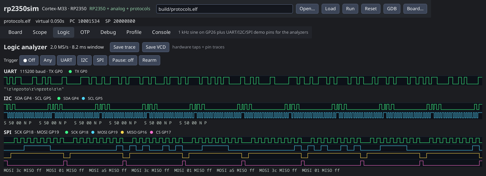

# rp2350sim

A Raspberry Pi RP2350 (Pico 2) emulator for developing, testing and debugging
firmware on a desktop. It runs unmodified **TinyGo** and **Pico SDK C**
programs, including RTOS firmware, with a live desktop UI for the board, its
peripherals and its pins.

## Install

**macOS** (Apple Silicon or Intel), with [Homebrew](https://brew.sh):

```sh
brew install akhenakh/tap/rp2350sim
```

**Arch Linux** (AUR), with `yay` or `paru`:

```sh
yay -S rp2350sim
# or
paru -S rp2350sim
```

Prebuilt Linux, macOS and Windows archives are on the
[GitHub Releases page](https://github.com/akhenakh/rp2350sim/releases). On other
Linux distributions, unpack the release archive and put `rp2350sim` and
`rp2350sim-ui` on `PATH`.

From source (Go 1.27.3+, no CGO):

```sh
git clone https://github.com/akhenakh/rp2350sim
cd rp2350sim
go build -o rp2350sim ./cmd/rp2350sim
(cd cmd/simui && go build -o rp2350sim-ui .)
```

## Logic analyzer



UART, I2C and SPI decoded next to the raw pin samples, with triggers and VCD
export. The same desktop UI also has a scope with FFT, an LCD view, a sensor
panel, debugging and profiling.

## Quick start

```sh
rp2350sim -fw firmware.elf -seconds 2        # headless: firmware console on stdout
rp2350sim-ui --board pico2 firmware.elf      # desktop UI, board picker on start
rp2350sim-ui --list-boards
```

Run a bundled demo (needs [Task](https://taskfile.dev) and TinyGo):

```sh
task run:blinky
task ui:logic
```

`-fw` accepts `.uf2`, `.elf` or raw binaries. The content of `println`/`printf`
goes to stdout; emulator diagnostics stay on stderr.

## Features

- **Cortex-M33 core** — RP2350/Pico 2 at 150 MHz, deterministic virtual time,
  dual-core SIO, NVIC/SysTick and the FPv5 single-precision FPU. Verified
  instruction by instruction against QEMU.
- **Stock firmware** — unmodified `tinygo build -target=pico2` programs and Pico
  SDK C binaries, including RTOS firmware such as Zephyr.
- **Peripherals** — GPIO, PIO0/1/2, DMA, PWM, paced ADC, UART, SPI, I2C, USB
  device (CDC, MIDI, HID), ST7789 LCDs, CST816D touch, QMI8658 IMU, microSD with
  a host-backed FAT16 directory, OTP fuses, QSPI PSRAM, TRNG/SHA-256, AON timer,
  watchdog, HSTX DVI, bootrom flash services and A/B partitions.
- **Networking** — W5500, W6300 and CH9120 Ethernet models, plus the Pico 2 W's
  **CYW43439** at the gSPI pins: the stock TinyGo Wi-Fi driver, a virtual access
  point (DHCP, DNS, NTP, ARP) and a **gVisor userland TCP/IP stack** with NAT to
  host sockets. Bluetooth HCI runs over the same gSPI bus.
- **Desktop UI** — board picker, LCD, sensors, Ethernet/Wi-Fi flows and pcap,
  scope with FFT and 10–90% measurements, logic analyzer, GPS/CAN/audio/MIDI/HID,
  OTP, Debug, Profile, Plugins and Console.
- **Debugging** — GDB remote server, breakpoints, watchpoints, registers,
  memory, source lines and DWARF locals/globals; a hang detector explains stuck
  poll loops with the SVD register and source line.
- **Profiling** — exact instruction/line coverage, LCOV export, sampled
  per-function cycles, IRQ latency histogram and stack watermarks.
- **Scripted devices** — Lua and compiled-WASM I2C, SPI and UART device models,
  plus built-in presets (BME280, SSD1306, MPU6050, W25Q16) and timed
  1-Wire/DHT/HC-SR04/GPS/CAN fixtures.
- **Headless and scriptable** — expect-style console assertions, JSON run
  summaries, PNG/WAV/VCD/pcapng artifacts and a full CI smoke suite.
- **Cross-platform** — pure Go, no CGO and no external runtime; Linux, macOS and
  Windows binaries, with a browser build of the UI and emulator.

## Documentation

The full user guide is in **[docs/](docs/README.md)** and published at
<https://akhenakh.github.io/rp2350sim/>.

| I want to… | Read |
|---|---|
| install, build, use TinyGo | [docs/README.md](docs/README.md), [docs/tinygo.md](docs/tinygo.md) |
| use the CLI and its flags | [docs/cli.md](docs/cli.md) |
| tour the desktop UI | [docs/ui.md](docs/ui.md) |
| wire a board or add one | [docs/boards.md](docs/boards.md), [docs/boards-yaml.md](docs/boards-yaml.md) |
| see every peripheral and board | [docs/peripherals.md](docs/peripherals.md) |
| script devices in Lua/WASM | [docs/plugins.md](docs/plugins.md) |
| debug firmware | [docs/debug.md](docs/debug.md) |
| profile and measure coverage | [docs/profiler.md](docs/profiler.md) |
| run Zephyr | [docs/zephyr.md](docs/zephyr.md) |
| understand CI and the smoke suite | [docs/ci.md](docs/ci.md) |
| cut a release | [docs/release.md](docs/release.md) |
| watch the feature tours | [docs/videos.md](docs/videos.md) |

## Testing

```sh
go test ./...
task ci        # lint, unit tests, QEMU corpus, C examples, smoke suite
```

`task ci` adapts to the host: all cores locally, a capped, less parallel run on
GitHub Actions. The smoke suite asserts pin waveforms, console output, LCD
pixels, network sockets and UI snapshots, not just "it compiled".

## Status

The Cortex-M33 (thumbv8m.main) is the contract: there is no RISC-V path, and
the USB controller is modelled as a device, not a host. Core 1 is started by the
`cores` scheduler (`tinygo build -scheduler=cores`); the default Pico 2 build
does not launch it. Windows binaries are built, but the bash smoke suite runs on
Linux and macOS. The interpreter is deterministic (one instruction, one cycle);
idle firmware fast-forwards, and a compute-bound loop runs at roughly 90M
instructions/s. The project is built with AI assistance and guarded by unit,
QEMU differential and firmware smoke tests — bug reports are welcome.

Apache-2.0. See [LICENSE](LICENSE).
