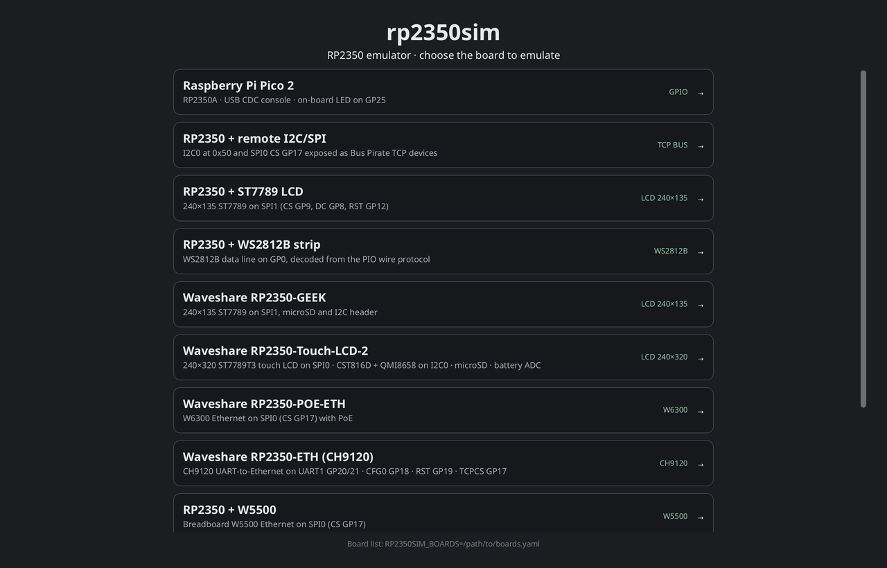
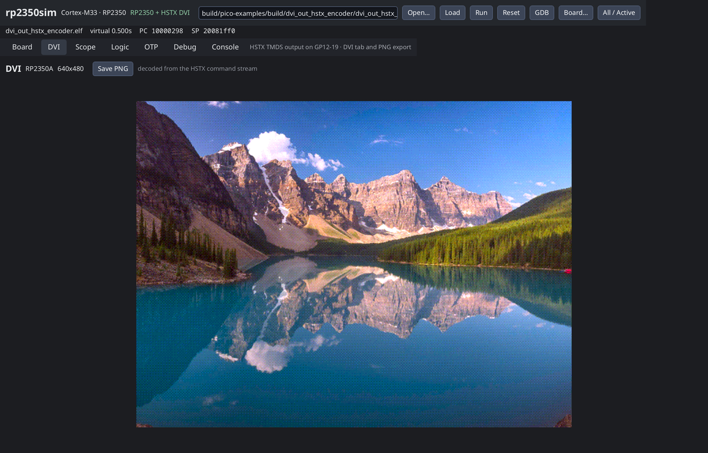
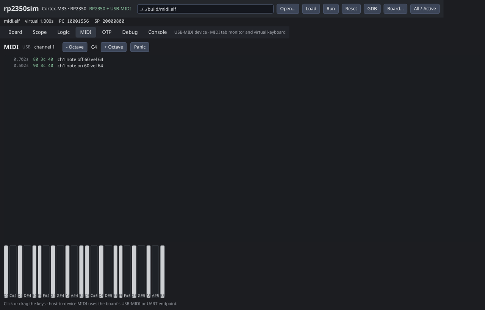

# rp2350sim documentation

`rp2350sim` runs unmodified `tinygo build -target=pico2` and stock Pico SDK C
firmware, including RTOS kernels such as **Zephyr**: a Cortex-M33 interpreter,
the RP2350 chip peripherals, and models for the boards and external chips
(ST7789 LCD, W5500/W6300/CH9120 Ethernet, WS2812B, virtual Wi-Fi). A Shirei
desktop UI adds board selection, live GPIO, a scope, a logic analyzer,
built-in bus presets, Bus Pirate terminals and a Source/Build drawer with live
reload.



This directory is the user guide. The same pages are rendered with Hugo and
the [Geekdoc](https://themes.gohugo.io/themes/hugo-geekdoc/) theme at
<https://akhenakh.github.io/rp2350sim/>; preview locally with `task docs:serve`.

## Recent features

- **RTOS support**: preemptive SVC/PendSV/SysTick exceptions, nested IRQs,
  per-core NVIC/SCB, banked MSP/PSP and lazy/eager floating-point frames.
  Zephyr 4.5 is validated on `rpi_pico2/rp2350a/m33` (hello world,
  synchronization, philosophers, blinky, kernel context, scheduler API and FPU
  sharing); the C `rtosctx` fixture covers context switching and critical
  sections. See the [Zephyr guide](zephyr.md).
- **Interactive board controls**: buttons, switches, rotary encoders, ADC pots
  and BOOTSEL declared in `boards.yaml` and scriptable with `--input`.
- **Debug variables**: every application global and local is shown in a
  scrollable list with its evaluated value.
- **Distribution**: Homebrew on macOS, AUR on Arch, and release archives with
  verifiable GitHub build provenance.

| Document | Contents |
|---|---|
| [install.md](install.md) | install the CLI and desktop UI on macOS, Arch, Linux or Windows |
| [videos.md](videos.md) | AI-generated video tours of the simulator |
| [cli.md](cli.md) | every command-line flag, output contract, exit codes, examples |
| [peripherals.md](peripherals.md) | each peripheral from both the CLI and the UI, with reference firmware and tasks |
| [bus-pirate.md](bus-pirate.md) | Bus Pirate tokens, built-in presets and recipes for faking I2C/SPI peripherals |
| [ui.md](ui.md) | the desktop UI: board picker, `boards.yaml`, tabs, scope, logic analyzer, bus presets, live reload and the Source/Build drawer |
| [debug.md](debug.md) | the Debug tab, symbols, breakpoints, watchpoints, memory and variables |
| [boards.md](boards.md) | supported boards, wiring, peripherals and current limitations |
| [ci.md](ci.md) | running firmware in CI, injecting input, asserting output and signals, capturing artifacts |
| [tinygo.md](tinygo.md) | installing, building with TinyGo, drop-in Taskfile/Makefile targets, dev loop |
| [c.md](c.md) | C firmware with the Pico SDK: build, examples, console, current gaps |
| [zephyr.md](zephyr.md) | Zephyr: SDK install, `rpi_pico2/rp2350a/m33` builds, validated samples and tests |
| [release.md](release.md) | release archives, GoReleaser, supported platforms |

## Install

Use Homebrew on macOS, the AUR on Arch, a prebuilt archive on Linux or
Windows, or build from source. See the [installation guide](install.md) for the
commands and release verification.

## Quick start

```sh
# Build firmware for the Pico 2 with TinyGo...
tinygo build -target=pico2 -o firmware.elf .
# ... or build a Pico SDK C project for PICO_BOARD=pico2 (see c.md).

# Run the resulting ELF for three virtual seconds
rp2350sim -fw firmware.elf -seconds 3

# Or inspect it in the UI
rp2350sim-ui --board pico2 firmware.elf
```

Both TinyGo and Pico SDK C images are first-class inputs; the rest of this
guide applies to either unless a section is explicitly about one toolchain.

Firmware console output goes to **stdout**; emulator diagnostics and the final
summary go to **stderr**, so `rp2350sim ... > firmware.log` captures only what
the firmware printed.

A minimal CI assertion:

```sh
printf 'status\n' | rp2350sim -fw firmware.elf -seconds 3 -stdin \
  -expect "status: ok" -stop-on-expect -quiet > firmware.log
```

See [ci.md](ci.md) for the full recipe.

## Supported targets at a glance

- **Raspberry Pi Pico 2** (RP2350A) and **RP2350B** (QFN-80, 48 GPIOs), TinyGo
  and **Pico SDK C**: GPIO, UART, SPI, I2C, PWM, ADC, PIO, USB CDC (TinyGo and
  TinyUSB), USB-MIDI, audio capture, DMA, timers, multicore, OTP, TRNG/SHA-256,
  the always-on timer, HSTX/DVI output, a GDB server and optional QSPI PSRAM on
  QMI CS1. Raw flash images may use the emulator's A/B partition table.
  See [c.md](c.md) for the C path and its current limits.
- **RTOS kernels**: Zephyr 4.5 (`rpi_pico2/rp2350a/m33`) and FreeRTOS-style
  preemptive kernels with SVC/PendSV/SysTick, per-core NVIC and floating-point
  context switching. See the [Zephyr guide](zephyr.md).
- **Pico 2 W**: a *virtual* Wi-Fi netdev backed by the host stack. The real
  CYW43439 radio and Bluetooth are not emulated; see [boards.md](boards.md).
- **Pico 2 + PSRAM**: optional 1–16 MiB QSPI device on QMI CS1, with a
  configurable access latency; see [boards.md](boards.md#psram).
- **Waveshare RP2350-GEEK**: ST7789 240×135, I2C header and microSD.
- **Waveshare RP2350-Touch-LCD-2**: 240×320 touch LCD, CST816D, QMI8658,
  battery ADC and microSD.
- **Waveshare RP2350-POE-ETH**: W6300 Ethernet on SPI0.
- **Waveshare RP2350-ETH** (non-PoE): CH9120 UART-to-Ethernet on UART1.
- Breadboard variants: W5500 on SPI0, ST7789, WS2812B, UART over TCP and
  remote I2C/SPI devices over Bus Pirate tokens.

## UI highlights

| DVI output | USB-MIDI |
|---|---|
|  |  |

The [UI guide](ui.md) covers the board picker, every tab, the scope and logic
analyzer, audio, MIDI, DVI and headless snapshots.

## Design notes

- The CPU is Cortex-M33 (`thumbv8m.main`); stock TinyGo firmware is the
  contract, and stock Pico SDK C images boot through the same vector table. The
  RP2350 bootrom itself is skipped; a synthetic table answers the SDK's
  `rom_func_lookup` calls.
- Time is virtual (150 MHz cycles); the emulator runs faster than real time,
  so `-seconds` is virtual time and `-wall-timeout` is real time.
- The headless runner is the automation surface; the UI is a separate module.
- ELF debug information drives the Debug tab and symbol breakpoints; UF2/raw
  images fall back to address breakpoints.
- The documents here are the user guide; implementation contracts live with
  the code.
