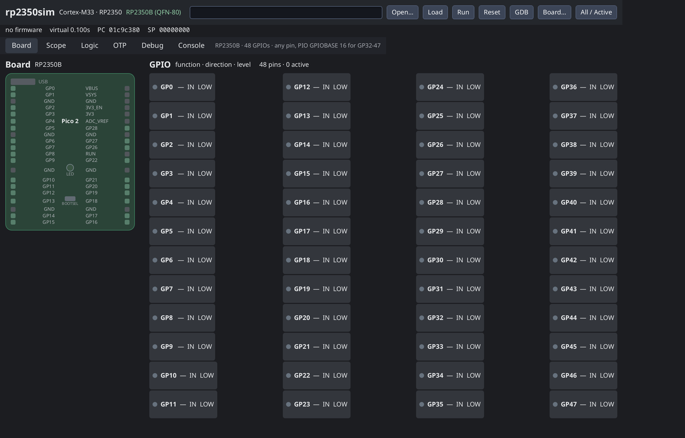
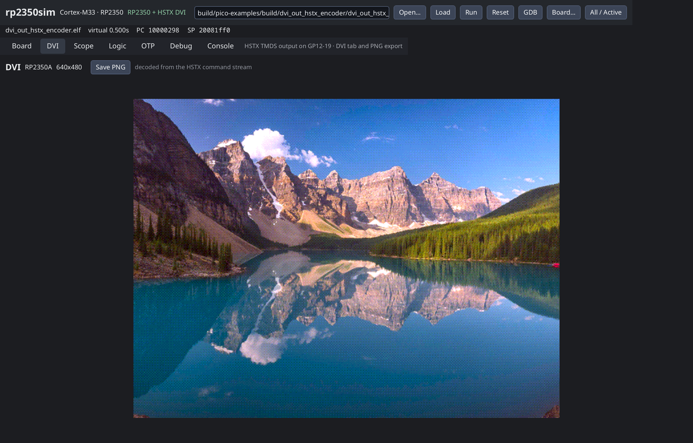
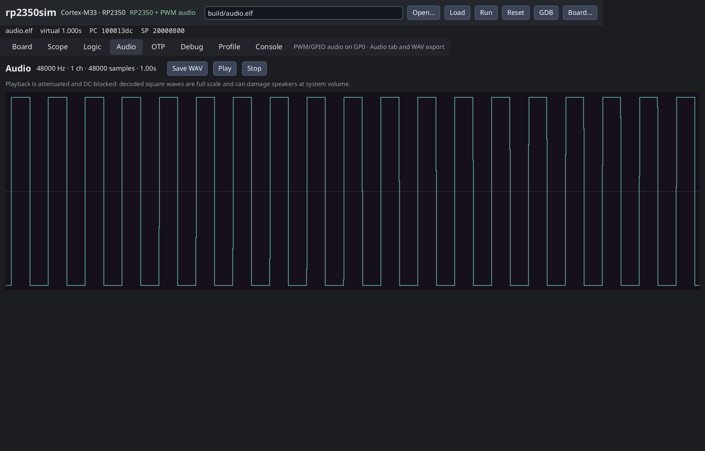
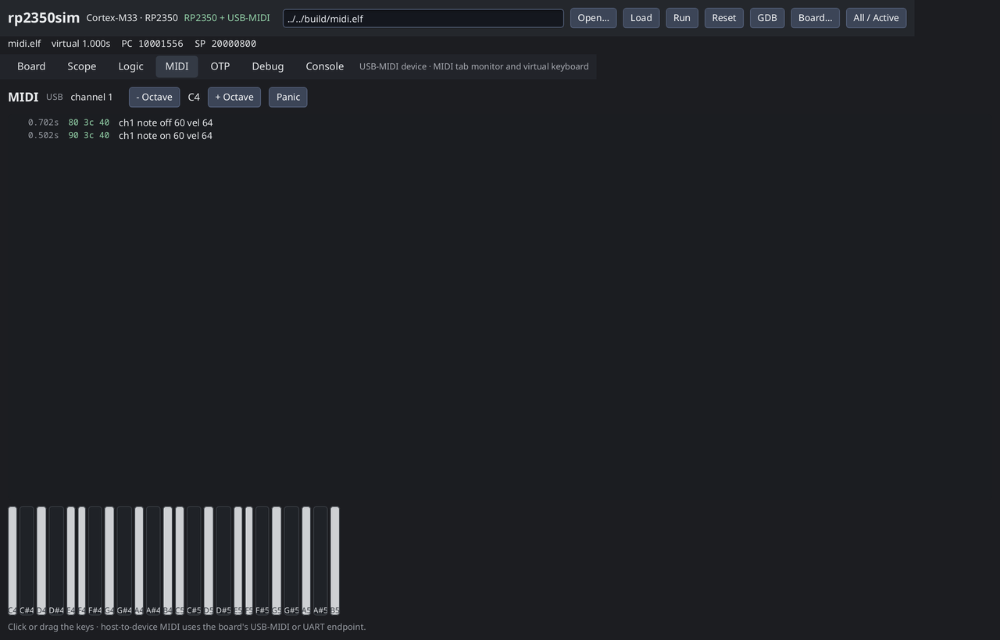

# Supported boards and peripherals

The emulated CPU is the ARM Cortex-M33 (`thumbv8m.main`), matching both
`tinygo build -target=pico2` and Pico SDK C `PICO_BOARD=pico2` output. Board
wiring below matches the headless flags and the UI board definitions.

[peripherals.md](peripherals.md) maps each board to its headless flags, UI tab
and reference firmware. In short:

| UI board | Headless flag |
|---|---|
| `pico2` | none |
| `pico2-lcd` | `-lcd` |
| `pico2-dvi` | `-dvi-png PATH` |
| `pico2b` | `-rp2350b` |
| `pico2-audio` | `-audio-pwm 0 -audio-out PATH` |
| `pico2-midi` | `-usb-midi -midi-monitor` |
| `pico2-midi-uart` | `-midi-uart 1 -midi-monitor` |
| `pico2-ws2812` | `-ws2812 0` |
| `geek` | `-lcd -sd` (or `-sd-dir`) |
| `touch-lcd2` | `-touch-lcd2` (plus `-touch`, `-sensors`, `-lcd-png`) |
| `pico2-w5500` | `-eth` |
| `poe-eth` | `-w6300` |
| `rp2350-eth` | `-ch9120` |
| `pico2w` | `-ch9120` (virtual Wi-Fi transport) |
| `pico2-serial` | `-serial-tcp 1:127.0.0.1:0` |
| `pico2-bus` | `-i2c-tcp`, `-spi-tcp` |
| `pico2-presets` | `-i2c-preset`, `-spi-preset` |
| `pico2-analog` | `-logic-*` (the generated waveform is UI-only) |
| `pico2-psram` | `-psram 8` |

## Raspberry Pi Pico 2 (RP2350A)

No device flags are needed. The core brings up the RP2350 peripherals the
TinyGo and Pico SDK runtimes use: GPIO/IO_BANK0/PADS, SIO, NVIC/SCB, timers,
clocks/PLL/XOSC, watchdog, UART0/1, SPI0/1, I2C0/1, PWM, ADC, DMA, USB device
+ CDC console, and PIO0/1/2. TinyGo `-scheduler=cores` and Pico SDK
`multicore_launch_core1` both boot core 1.

## Waveshare RP2350-GEEK

- ST7789VW 240×135 on SPI1: CS GP9, DC GP8, RST GP12, backlight GP25.
- microSD on SPI0: SCK GP18, MOSI GP19, MISO GP20, CS GP23. The card is backed
  by the real host directory `sdcards/geek` by default: files are packed into
  a FAT16 image at startup and firmware writes are mirrored back. `-sd-dir`
  changes the directory; `-sd-image` uses a raw image instead. Use `-sd`
  (runner) or the `geek` UI board.
- The 3-pin SWD/UART and 4-pin I2C headers are pass-through connectors to the
  target board, not on-board devices.
- Use `-lcd` (runner) or the `geek` UI board; `-lcd-png out.png` exports the
  framebuffer.
- Reference firmware: `firmware/lcd`, a font splash using
  `tinygo.org/x/tinyfont` and `freesans`. The title color and accent bars
  cycle through the palette, exercising full-frame fills, text rendering,
  partial updates and rotation.

## Waveshare RP2350-Touch-LCD-2

- ST7789T3 240×320 IPS on SPI0: SCK GP18, MOSI GP19, CS GP17, DC GP16,
  RST GP20 (shared with touch), backlight GP15.
- CST816D touch on I2C0 at `0x15`: SDA GP12, SCL GP13, INT GP29, RST GP20.
  Reports finger count and raw X/Y at `0x02..0x06`; chip ID `0xA7` = `0xB6`.
- QMI8658 6-axis IMU on I2C0 at `0x6B`: INT1 GP14. Accelerometer defaults to
  ±8 g (4096 LSB/g) with +1 g on Z; the range follows CTRL2. Data-ready INT1
  is a level that clears when the output or status register is read.
- Battery monitor: GP28/ADC2 through a ÷3 divider (3.9 V battery ≈ 1.3 V).
- microSD on SPI1: SCK GP26, MOSI GP27, MISO GP24, CS GP25. Backed by
  `sdcards/touch-lcd2` by default (a real host directory, see below);
  `-sd-dir` or `-sd-image` override it.
- The camera connector (DVP on GP0-GP11, SCCB on I2C1 GP22/GP23) is a
  connector for an optional OV2640/OV5640 module and is not emulated.
- Use `-touch-lcd2` (runner) or the `touch-lcd2` UI board. `-lcd-png` exports
  the 320×240 rotated frame; `-touch x,y` injects a tap (native panel
  coordinates), and `-touch-at`/`-touch-hold` place it in virtual time.
- Reference firmware: `firmware/touchlcd`, which initialises the panel, touch,
  IMU, backlight and ADC, prints deterministic values and draws touch points.

## PSRAM

QMI chip select 1 can carry a QSPI PSRAM device at `0x11000000`. The
`pico2-psram` UI board attaches an 8 MiB part on GP8 with a 6-cycle access
stall; the headless equivalent is:

```sh
rp2350sim -fw firmware/c/build/psram.elf -seconds 2 \
  -psram 8 -psram-cs 8 -psram-latency 6
```

The RP2350A QMI CS1 pin must be GP0, GP8 or GP19 (the RP2350B adds GP47).
`-psram` writes the `FLASH_DEVINFO` boot-RAM field the SDK reads, sets up the
QMI window and answers the APS6404 JEDEC ID. Window 1 is read-only until
firmware enables `XIP_CTRL.WRITABLE_M1`; the uncached mirrors
(`0x15000000`, `0x19000000`, `0x1d000000`) alias the same bytes. `latency` is
the extra virtual time per access; raise it to model a slower part, or use 0
for SRAM-like timing. The C example `firmware/c/psram` verifies the size and a
1 MiB pattern.


A card can be backed by a host directory (`sd.dir` in `boards.yaml`, or
`-sd-dir PATH`). The directory is packed into a 16 MiB FAT16 image at startup
and the image is mirrored back after firmware writes settle (about 50 ms of
virtual time). Drop files into the directory before starting, or read files
the firmware creates while it runs; files deleted on the card are removed
from the directory too. Host files that were not part of the card are never
deleted, and symlinks are skipped. Host edits made while the emulator is
running are picked up on the next start, not live.

The UI uses `sdcards/<board>` relative to its working directory by default.
`-sd-image PATH` uses a raw FAT image instead; `image` and `dir` are mutually
exclusive.

## Network endpoints

Ethernet and Wi-Fi sockets are backed by host sockets. A server firmware's
listener binds the host's wildcard address on the guest's source port, so it is
reachable at `127.0.0.1:<port>` (or a LAN address); the configured guest IP
(`10.0.2.15` in the examples) is an emulated identity, not a host route. The
runner logs `host=` and `guest=` addresses whenever the state changes, and the
Ethernet/Wi-Fi tab shows the same per socket with the host address to connect
to.

## Waveshare RP2350-POE-ETH (W6300)

- W6300 on SPI0: SCK GP18, MOSI GP19, MISO GP16, CS GP17.
- Use `-w6300` for the fitted controller.
- The in-tree TinyGo netdev driver is `drivers/w6300`; the chip model is
  `internal/devices/w6300.go`.
- Reference firmware: `firmware/w6300` (TCP client/server, UDP client/server).
  UDP sockets bind the guest `Sn_PORT`; received datagrams are stored with the
  WIZnet 8-byte peer header, which `drivers/w6300` strips on receive.

## W5500 (breadboard)

- W5500 on SPI0: SCK GP18, MOSI GP19, MISO GP16, CS GP17.
- Use `-eth` (runner) or the `pico2-w5500` UI board.
- The stock `tinygo.org/x/drivers/w5500` netdev driver runs unmodified; the
  chip model is `internal/devices/w5500.go`.
- Reference firmware: `firmware/w5500` (TCP client/server, UDP client/server).
  UDP clients bind the guest source port and received datagrams carry the
  WIZnet 8-byte peer header, as on hardware. The stock TinyGo driver's `Recv`
  does not skip that header; use the socket API directly for UDP receives.
  The stock driver rejects the 16-byte IPv4-mapped address that `net.IPv4`
  returns, so the client passes a 4-byte `net.IP{127,0,0,1}`.

## Waveshare RP2350-ETH (CH9120, non-PoE)

- CH9120 UART-to-Ethernet module:
  - CH9120 RXD ← RP GP21 (UART1 TX)
  - CH9120 TXD → RP GP20 (UART1 RX)
  - TCPCS → GP17 (low = TCP connected)
  - CFG0 ← GP18 (low = serial configuration mode)
  - RSTI ← GP19 (active low)
- Use `-ch9120` or the `rp2350-eth` UI board.
- The module speaks a serial command set (`0x57 0xab …`, `0xaa` replies); the
  TinyGo driver is `drivers/ch9120`, and `firmware/ch9120` configures a TCP
  client against the host echo server.
- The emulator's module proxies TCP/UDP client/server sockets to the host
  network stack; TCPCS and the status line are visible in the UI.

## Raspberry Pi Pico 2 W (virtual Wi-Fi)

**This is a fake, not a CYW43439 emulation.** The real board's Infineon
CYW43439 uses a gSPI transport, a firmware/NVRAM download, WLC IOCTLs,
SDPCM/BDC frames and a Bluetooth stack. Emulating that faithfully is out of
scope, and `soypat/cyw43439` firmware does not run here.

What works instead:

- The `pico2w` UI board (and the same wiring as the CH9120 above) attaches a
  host-backed serial netdev.
- `drivers/ch9120.NetDevice` implements a one-socket `netdev.Netdever`
  (`Socket`/`Bind`/`Connect`/`Listen`/`Accept`/`Send`/`Recv`).
- Firmware calls `netdev.UseNetdev` and then uses TinyGo's `net` package
  normally; `firmware/wifi` dials a host TCP echo, writes a line every 500 ms
  and prints each reply as `wifi echo: hello wifi`.
- Bluetooth (LE/Classic) is **not** modelled.

If you need CYW43439 fidelity, that is a separate, firmware-level emulation
project.

## Breadboard W5500

- W5500 on SPI0 CS GP17; use `-eth` or the `pico2-w5500` UI board.
- The stock `tinygo.org/x/drivers/w5500` netdev driver works unchanged.

## WS2812B

- Single-wire GRB, 24 bits per LED, 1.25 µs bits, T0H ~0.4 µs / T1H ~0.8 µs,
  >50 µs reset. TinyGo drives it through PIO.
- Use `-ws2812 GPIO` or the `pico2-ws2812` UI board; the last frame is decoded
  into colours. Reference firmware: `firmware/ws2812`.

## RP2350B (QFN-80)

- `-rp2350b`, or `package: qfn80` in `boards.yaml`, selects the QFN-80 variant:
  `SYSINFO.PACKAGE_SEL` reads 0 and the Board tab lists 48 GPIOs. The default
  is the RP2350A QFN-60 with 30 GPIOs.
- PIO's block-wide `GPIOBASE` register selects a 0-31 or 16-47 pin window, so
  programs that need GP32-47 use `pio_set_gpio_base(pio, 16)`. The UI boards
  `pico2b` and the `-rp2350b` flag expose the extra pins in the scope and GPIO
  table.



## HSTX and DVI

The RP2350 HSTX block is modelled at `0x400C0000` (control) and `0x50600000`
(FIFO). The model decodes the command expander's RAW/TMDS command stream into
pixels and renders complete DVI frames; it does not model the serial TMDS
output or bit timing.

- `-dvi-png PATH` writes the last frame headlessly. The **DVI** tab shows it
  live and offers **Save PNG**.
- The `pico2-dvi` UI board enables the tab. The reference firmware is the
  stock `pico-examples` `hstx/dvi_out_hstx_encoder` (640x480 RGB332 on
  GP12-19); `task picoexamples:build` builds it and the smoke suite asserts a
  640x480 frame. `task ui:dvi` opens the board and tab, and `task ui:dvi:png`
  renders it headlessly.
- Frame height is inferred from the active width (640→480, 320→240, 800→600,
  1280→720); HSTX itself carries no vertical timing.
- The model consumes the single-word RAW_REPEAT blanking used by the example.
  RAW with a count above one and TMDS_REPEAT's shift-register recirculation are
  not expanded; they are noted as fidelity gaps, not used by the DVI demo.



## TRNG, SHA-256 and the AON timer

- TRNG at `0x400F0000`: deterministic splitmix64 EHR words, valid/busy flags
  and interrupt clear. `pico_rand` and the `system/rand` example pass their
  distribution checks.
- SHA-256 at `0x400F8000`: START/BSWAP, WDATA (word/byte/halfword writes,
  including DMA_SIZE_8), SUM0-7. The pico-examples `sha/sha256` vector and
  1 MB NIST test pass with and without DMA. DREQ pacing is still absent.
- POWMAN at `0x40100000`: the AON 1 kHz millisecond timer, set/read time,
  alarm and timer IRQ (45). `firmware/c/aontimer` exercises `pico_aon_timer`;
  deep-sleep power state sequencing is not modelled.

## Audio and MIDI
Both are host-side taps on GPIO or USB; no board wiring is needed beyond the
pins the firmware drives.

- **Audio:** `-audio-pwm PIN`, `-audio-i2s bclk,lrclk,data[,bits]` or
  `-audio-pdm data,clock[,decimation]`, plus `-audio-out out.wav`. UI boards
  `pico2-audio` (`audio: {kind: pwm, pin: 0}`) and any `audio:` key in
  `boards.yaml`. Reference firmware: `firmware/audio` (GP0 square wave).
- **MIDI:** `-usb-midi` for the USB-MIDI class endpoint, `-midi-uart N` for a
  31250-baud UART, `-midi-monitor` and `-midi-udp ADDR` for the bridge. UI
  boards `pico2-midi` (USB-MIDI) and `pico2-midi-uart` (UART1 GP4/GP5).
  Reference firmware: `firmware/midi` (USB note traffic plus UART echo).





## UART over TCP

Any board can expose UART0/UART1 as a TCP server for interactive work. The
headless form is `-serial-tcp 1:127.0.0.1:0` (the assigned port is printed on
stderr); the UI board key is `serial: [{uart: 1}]`.

## Current limitations

- **CYW43439 / Bluetooth:** not emulated; the Pico 2 W uses the virtual Wi-Fi
  described above.
- **Core 1:** works with `-scheduler=cores` (SIO launch, WFE/SEV, tasks on both
  cores). The default TinyGo tasks scheduler is single-core. The SCS page is
  banked per core: VTOR, NVIC enable/pending/priority state, SysTick and the
  system-exception pending bits are private, and shared peripheral IRQs are
  replicated to both cores.
- **Exceptions and nesting:** preemptive priority nesting, 4 priority bits,
  tail-chaining, PendSV, SysTick (CPU clock and 1 MHz reference), SVC (with
  HardFault escalation when masked), NMI, PRIMASK/FAULTMASK/BASEPRI and
  MSPLIM/PSPLIM are supported. A Zephyr/FreeRTOS-style supervisor kernel
  (PSP tasks, SVC first-task launch, PendSV switching) runs; see
  `firmware/c/rtosctx` and the [Zephyr guide](zephyr.md). Zephyr v4.5.0
  `rpi_pico2/rp2350a/m33` builds boot, and the context, scheduler, threads and
  FPU-sharing tests pass.
- **Floating point exceptions:** extended frames, eager and lazy (ASPEN/LSPEN,
  LSPACT) stacking are modelled, including handlers that save EXC_RETURN before
  their first FP instruction.
- **Not enforced:** MSPLIM/PSPLIM violations, CPACR gating and the MPU/SAU
  registers (they are stored and readable, but no protection is applied), so
  `CONFIG_USERSPACE` isolation and stack-guard faults are not modelled.
  Fault escalation beyond masked SVC (bus/usage/mem faults) is not generated.
- **Peripheral interrupts:** NVIC lines are wired for DMA, both timers, UART RX,
  USB, PIO, POWMAN, SIO FIFO (25) and SIO doorbell (26). SPI, I2C, ADC,
  GPIO-edge and PWM wrap interrupts are not delivered yet.
- **BOOTSEL:** the Board tab's BOOTSEL control (and a YAML `bootsel` input)
  pulls the QSPI chip-select line low. It latches so it can stay held through a
  Reset; the board diagram button is momentary. Firmware reads the line through
  `SIO_GPIO_HI_IN` bit 27 (QSPI_CSN), as the TinyUSB BSP does, and the reset
  sample is recorded (`Chip.BootselAtBoot`). The synthetic bootrom does not
  enter USB mass-storage/picoboot boot mode, so no disk appears. On real
  hardware a held BOOTSEL also jams QSPI CS and breaks XIP execution; the
  emulator deliberately keeps flash readable so firmware that polls the pin
  still runs.
- **PIO OUT:** an empty OSR is refilled from the TX FIFO even when autopull is
  disabled, because TinyGo's `SetX`/`SetY` rely on it. Treat this as more
  permissive than hardware when porting hand-written PIO.
- **VFP/DSP:** VFMA/VFMS are separate multiply/add (up to 1 ulp from fused
  hardware); `SEL` does not model the GE flags. Unsigned-saturating and
  parallel DSP instructions (USAT/SSAT, QADD, SADD/UADD16, ...) halt rather
  than execute.
- **USB host:** the emulated host enumerates the device from its configuration
  descriptor, follows the DPRAM buffer addresses in `EP_CONTROL`, and pumps
  CDC (TinyGo and TinyUSB) and USB-MIDI; arbitrary USB classes and isochronous
  endpoints are not supported.
- **DMA:** paced transfers, AL1/AL2/AL3 aliases and completion interrupts, but
  no DREQ pacing.
- **Timers:** the 64-bit read pair is latched, but writes to TIMEHW/TIMELW are
  ignored; firmware cannot set the timer.
- **Package/pins:** SYSINFO reports the selected package: RP2350A QFN-60 by
  default, RP2350B QFN-80 with `-rp2350b` or `package: qfn80`. The GPIO model
  always covers 48 pins and the coprocessor can touch GP32-47; the board and
  scope expose 30 pins for the A and 48 for the B. Treat the pin model as a
  superset; the QMI CS1 constraint (GP0/GP8/GP19) is documented, not enforced.
- **High-speed peripheral buses:** UART/SPI/I2C traffic is tapped at the
  controller-model level for the logic analyzer; the emulated GPIO pins do not
  toggle at bus bit rates. PIO/bit-banged traffic is decoded from pins.
- **PSRAM/QSPI:** the QMI CS1 PSRAM model covers memory-mapped data and the
  SDK setup/ID path; it is not a cycle-accurate QSPI bus, and PSRAM is only
  attached when a board or `-psram` asks for it.
- **Network tests** depend on host servers and wall-clock timing; see
  [ci.md](ci.md).

## Firmware examples in this repository

| firmware | demonstrates |
|---|---|
| `firmware/blinky` | GPIO and timing |
| `firmware/lcd` | ST7789 over SPI |
| `firmware/sdcard` | microSD over SPI with the stock TinyGo driver: card identity, FAT16 boot sector and root directory (long names included) |
| `firmware/touchlcd` | Touch-LCD-2: ST7789, CST816D, QMI8658, ADC, microSD |
| `firmware/piotest` | PIO API conformance (FIFOs, autopush/pull, IRQ, side-set) |
| `firmware/ws2812` | WS2812B strip over PIO |
| `firmware/audio` | GPIO square wave for the audio decoder and WAV export |
| `firmware/midi` | USB-MIDI traffic and UART MIDI echo |
| `firmware/cores` | `-scheduler=cores` and core 1 |
| `firmware/echo` | USB CDC console input |
| `firmware/uart` | UART output for the logic analyzer |
| `firmware/protocols` | UART/I2C/SPI traffic for the logic analyzer |
| `firmware/serialbridge` | UART1 echoed over TCP |
| `firmware/busmaster`, `firmware/busdevice` | I2C/SPI Bus Pirate bridges |
| `firmware/debugvars` | DWARF locals and globals for the Debug tab |
| `firmware/w5500` | W5500 TCP client/server and UDP (stock driver) |
| `firmware/w6300` | W6300 TCP client/server and UDP |
| `firmware/ch9120` | CH9120 TCP client |
| `firmware/wifi` | virtual Wi-Fi through `netdev` |
| `firmware/c/*` | Pico SDK C examples (see [c.md](c.md)) |
