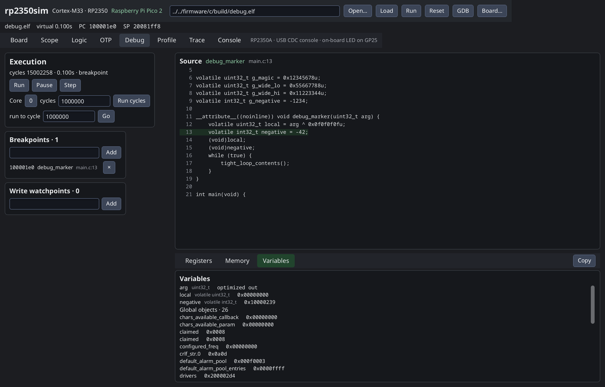

# Debugging firmware

The desktop UI has a **Debug** tab and the headless runner accepts breakpoints by
address or symbol. Both use the same ELF debug information: function symbols,
DWARF source lines and the variables the compiler left locations for.



```sh
# UI: open the tab, stop at a symbol, and show the machine there
rp2350sim-ui --board pico2 --tab debug --break debug_marker firmware.elf

# UI: open the inspector on Variables (or memory) instead of registers
rp2350sim-ui --board pico2 --tab debug --break main.marker \
  --debug-tab variables build/debugvars.elf

# Headless: log a breakpoint and continue
rp2350sim -fw firmware.elf -seconds 2 -bp debug_marker

# Watch a symbol or address
rp2350sim -fw firmware.elf -seconds 2 -watch g_magic
```

## The Debug tab

- **Execution**: Run, Pause, Step one instruction, Run N cycles and Run to an
  absolute cycle count. A Step executes one instruction on the selected core;
  the other core stays halted. Cycle counts are virtual 150 MHz cycles, so
  exceptions and slow external memory are visible in the delta.
- **Breakpoints** can be entered as `0x...` or as an ELF symbol
  (`main.main`, `debug_marker`, `main`). The list shows the resolved address,
  function and source line. Address breakpoints also work for UF2/raw images,
  which have no symbols.
- **Write watchpoints** stop when firmware writes the resolved address. A
  watchpoint is checked on 8/16/32-bit writes; the write still completes.
- **Source** shows the lines around the current PC when the DWARF file is
  present on this machine. A short name, function and `file:line` are shown
  even when the source tree is from another build host.
- The lower third of the tab is a **Registers / Memory / Variables** inspector.
  - **Registers** shows R0-R15, APSR, IPSR, CONTROL, MSP and PSP.
  - **Memory** is a read-only hex/ASCII view. It uses side-effect-free `Peek`
    reads for ROM, flash, SRAM and PSRAM: it does not charge PSRAM latency and
    never reads a UART/SPI/I2C/FIFO register. **PC** and **SP** jump to the
    current locations.
  - **Variables** evaluates the current function's locals and globals.

## Variables and limitations

The debugger uses the DWARF expressions that embedded compilers normally emit:

- constants (`DW_AT_const_value`);
- absolute addresses (`DW_OP_addr`);
- registers and register-relative values (`DW_OP_reg*`, `DW_OP_breg*`);
- stack/frame-relative slots (`DW_OP_fbreg`), using the CFA recovered from
  `.debug_frame`;
- basic arithmetic used by optimized expressions.

A value that the compiler optimized away, or a location form the evaluator does
not support, is shown as `optimized out`, `unsupported location` or
`unreadable`. It is never guessed.

Pico SDK C builds at `-O3` keep `volatile` locals, so the bundled
`firmware/c/debug` fixture exposes `local` and the globals reliably. TinyGo
programs often encode known locals as DWARF constants; the
`firmware/debugvars` fixture checks those. Full C++/Go expression evaluation,
call-stack unwinding and disassembly are not part of this debugger.

## Breakpoints from the CLI

`-bp` and `-bp2` accept a hex address or a symbol when `-fw` is an ELF with a
symbol table. `-watch` accepts the same forms. A missing symbol is a usage
error (exit 2), not a silent miss.

```sh
rp2350sim -fw firmware/c/build/debug.elf -seconds 1 -bp debug_marker \
  -log-format text
rp2350sim -fw firmware/c/build/debug.elf -seconds 1 -watch g_magic
```

The breakpoint record includes `symbol`, `file` and `line` when available. An
exact symbol match wins over a hexadecimal interpretation, so a symbol named
`face` is not mistaken for an address. `-trace`, `-bp`, `-watch` and
`-watch-val` can be combined. The existing `-trace-last`, `-poke` and `-peek`
flags remain available for non-interactive diagnosis.

`UF2` and raw binary images carry no symbol or DWARF data. Use an address, or
load the matching ELF if one is available.

## GDB remote protocol

The server grants full memory read/write to anyone who can connect. Keep the
default loopback bind unless the network is trusted; `-gdb 0.0.0.0:3333` is
deliberately not the default.

The runner and the UI can expose the same breakpoints, watchpoints, registers
and memory over the GDB Remote Serial Protocol.

```sh
# Headless: listen for a client; the firmware runs until one attaches
rp2350sim -fw build/blinky.elf -gdb 127.0.0.1:3333

# In another terminal: load symbols from the ELF, then attach
arm-none-eabi-gdb build/blinky.elf
(gdb) target remote 127.0.0.1:3333
(gdb) info threads
(gdb) monitor reset
(gdb) break main.main
(gdb) continue
(gdb) info registers
(gdb) x/8xw 0x20000000
(gdb) stepi
(gdb) watch *(int*)0x400b0020
(gdb) monitor reset
(gdb) detach
```

- Threads are the two cores: `Thread 1 "core0"` and `Thread 2 "core1"`.
  `thread 2` selects core 1 for registers and stepping.
- `Z0`/`Z1` are execution breakpoints and `Z2` is a write watchpoint. `Z3`/`Z4`
  (read/access watchpoints) are rejected as unsupported rather than pretending
  to work. They use the same debugger as the Debug tab, so `-break` symbols and
  GDB breakpoints can coexist.
- `s`/`stepi` and `vCont` step one instruction on the selected core; a step
  wakes a core sleeping in WFE/WFI.
- `continue` resumes all cores. A client interrupt (Ctrl-C) halts the target.
- `monitor reset` reboots the image and leaves it stopped at the reset vector.
- Memory reads cover ROM, flash, SRAM and PSRAM through side-effect-free
  peeks. Reads of peripheral addresses (needed when GDB evaluates a watchpoint
  expression) fall back to the bus, so they can have the same side effects as
  firmware reading the register. `M`/`X` writes reach SRAM and peripherals;
  writes to the flash range update the backing array so GDB `load` works.
- The default `-steps` budget is disabled when `-gdb` is the only run limit, so
  the target behaves like a board that keeps running. Pass `-seconds` or
  `-steps` to bound it. `-gdb` and `-sample` are mutually exclusive.
- The UI exposes the same server: `rp2350sim-ui --gdb 127.0.0.1:3333` starts it
  at launch, and the toolbar **GDB** button starts or stops it on the configured
  address (default `127.0.0.1:3333`). The second toolbar row shows the listening
  address while it is active.

A non-interactive attach looks like this (the Python-data-directory warnings
are trimmed):

```text
$ arm-none-eabi-gdb -q -batch --data-directory=/usr/share/gdb \
    -ex 'file build/debugvars.elf' -ex 'target remote 127.0.0.1:3333' \
    -ex 'break main.marker' -ex continue -ex 'info registers pc sp' -ex detach
Breakpoint 1 at 0x10002024: file firmware/debugvars/main.go, line 21.
Thread 1 "core0" hit Breakpoint 1, main.marker (arg=305419896) at ...
pc             0x10002024          0x10002024 <main.marker+16>
sp             0x20003850          0x20003850
[Inferior 1 (Remote target) detached]
```

## Fixtures and tests

Two deterministic fixtures exercise the debugger end to end:

- `firmware/c/debug`: `g_magic = 0x12345678`, `g_wide_lo`, `g_wide_hi`,
  `g_negative`, and a noinline `debug_marker` whose volatile `local` is
  `0xaaaaaaaa`.
- `firmware/debugvars`: a TinyGo program whose `main.marker` has the constant
  arguments `arg = 0x12345678` and `local = 0x1d3b5977`.

```sh
task debug:test     # build both fixtures and run the DWARF tests
task c:debug        # run the C fixture and stop at debug_marker
task ui:debug       # open the Debug tab on it
task ui:debug:png   # headless screenshot to build/ui-debug.png
```

The tests load the real ELFs, run the emulator to a breakpoint, evaluate the
same `VariablesAt` path the UI uses and compare the values. They skip when a
fixture has not been built.
