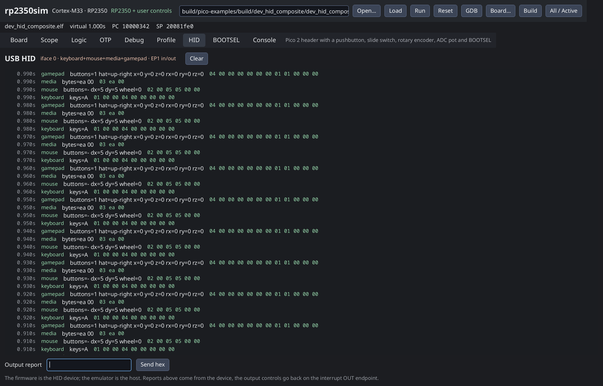

# USB HID

The RP2350 USB controller can be a HID device. `rp2350sim` is the USB host: it
enumerates the device, reads the HID report descriptor, decodes input reports
and can send output reports back. The same model is used by the **HID** tab and
by the headless runner.



## What is supported

- Keyboard, mouse, consumer/media and gamepad reports.
- Composite devices with several HID interfaces.
- Report IDs and per-report sizes and logical ranges taken from the report
  descriptor, so custom gamepad layouts work without a hardcoded format.
- Standard device enumeration: configuration descriptor, interface and endpoint
  descriptors, HID report descriptor, `SET_IDLE`.
- Interrupt IN reports and interrupt OUT reports (keyboard LEDs, gamepad
  feedback, generic output reports).

The firmware is the device and the emulator is the host. The monitor therefore
shows **device-to-host** reports; the output controls send **host-to-device**
reports.

## HID tab

The tab appears once the firmware enumerates a HID interface. The header names
the interface and its report kinds, for example:

```text
USB HID  iface 0 · keyboard+mouse+media+gamepad · EP1 in/out
```

The monitor lists reports newest first with:

- virtual time in seconds;
- decoded kind (`keyboard`, `mouse`, `media`, `gamepad`);
- readable text (`keys=A`, `buttons=left dx=12`, `buttons=1 hat=right`);
- the raw report bytes in hex.

The bottom row sends host-to-device output: **Num/Caps/Scroll** keyboard LEDs
and a generic output-report hex field with **Send hex**. Keyboard LEDs use the
report ID from the firmware's report descriptor; a boot keyboard without report
IDs gets the one-byte LED report.

```sh
task ui:hid            # TinyGo keyboard + mouse
task ui:hidgamepad     # TinyGo joystick
task ui:hid:composite  # pico-sdk keyboard/mouse/media/gamepad
task ui:hid:png        # render the tab to build/ui-hid.png
```

`ui:hid:composite` latches BOOTSEL because the pico-sdk `dev_hid_composite`
example only reports while that pin is held.

## Headless

| flag | meaning |
|---|---|
| `-usb-hid` | log every decoded input report |
| `-hid-out HEX` | send one output report once the interrupt OUT endpoint is armed |

```sh
# Keyboard and mouse reports
rp2350sim -fw build/hid.elf -seconds 3 -usb-hid

# Send NumLock (report 02, LED bit 01) after enumeration
rp2350sim -fw build/hid.elf -seconds 3 -usb-hid -hid-out 0201

# Report IDs and a custom gamepad layout
rp2350sim -fw build/hidgamepad.elf -seconds 3 -usb-hid

# pico-sdk composite example: it reports while BOOTSEL is held
rp2350sim -fw dev_hid_composite.elf -seconds 1 -bootsel -usb-hid
```

Reports are `slog` records on stderr:

```json
{"msg":"usb hid","interface":0,"kind":"keyboard","report":"keys=A","bytes":"01 00 04 00 00 00 00 00"}
{"msg":"usb hid","interface":0,"kind":"mouse","report":"buttons=left dx=0 dy=0 wheel=0","bytes":"01 01 00 00 00"}
```

Use `-quiet` only if you do not need the report stream; `-usb-hid` records are
informational.

## Reference firmware

- `firmware/hid` — TinyGo keyboard + mouse + media descriptor.
- `firmware/hidgamepad` — TinyGo joystick with report IDs.
- pico-sdk `dev_hid_composite` — keyboard, mouse, media and gamepad in one
  composite device; reports only while BOOTSEL is held.

All three are covered by `task smoke` / the pico-examples checks.

## Browser

The HID tab works in the WebAssembly build, including the report monitor and
output controls. Like the rest of the browser build it has no host sockets or
process execution, but HID needs neither. See the
[browser build](wasm.md).

## Limits

- One device configuration with interrupt IN and optional interrupt OUT
  endpoints. USB hubs, suspend/resume, isochronous transfers and feature-report
  control transfers are not modelled.
- The emulator decodes HID input reports; it does not inject keyboard or mouse
  input into the firmware. Firmware sees only the device's own reports and the
  output reports you send.
- CDC and MIDI are separate USB models; a composite CDC+HID device exposes both
  consoles/tabs, but their traffic is not mixed.
