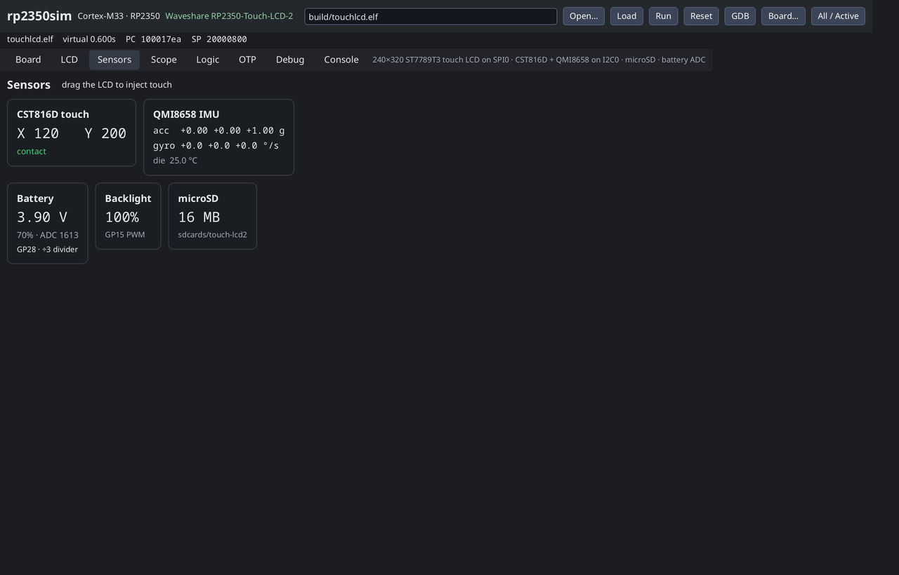
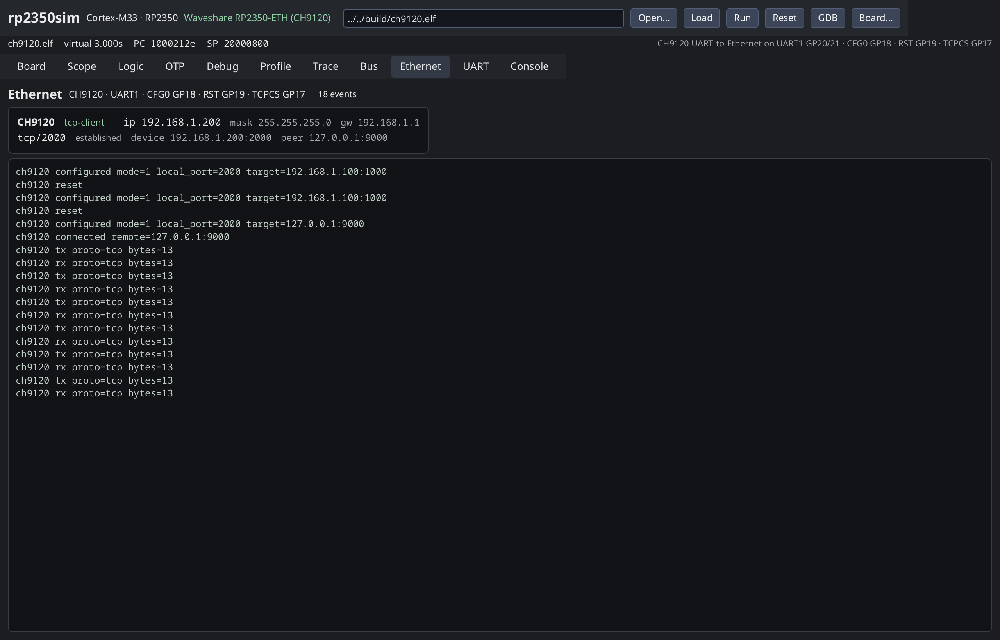
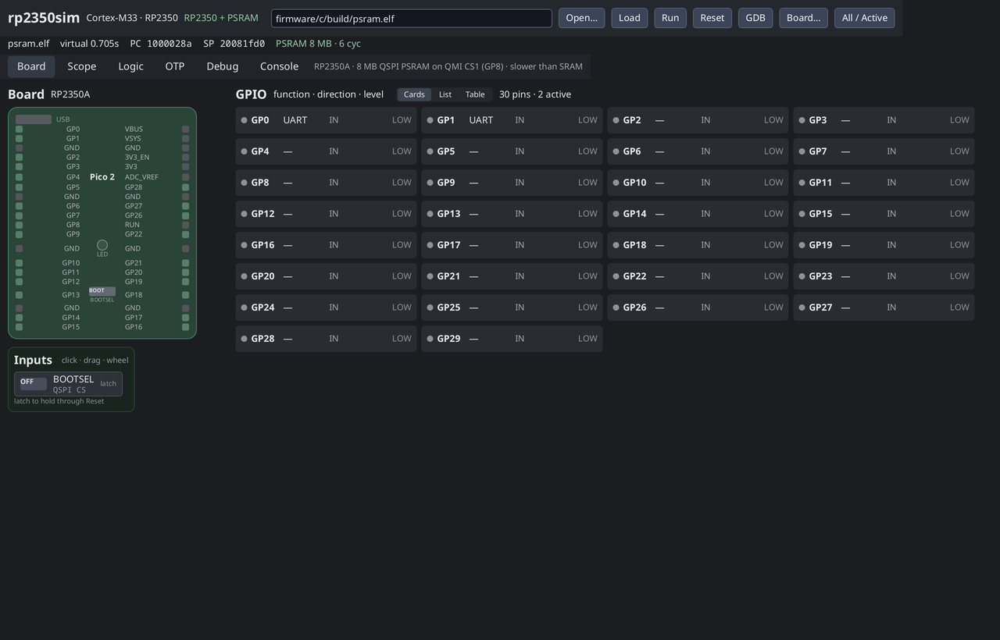
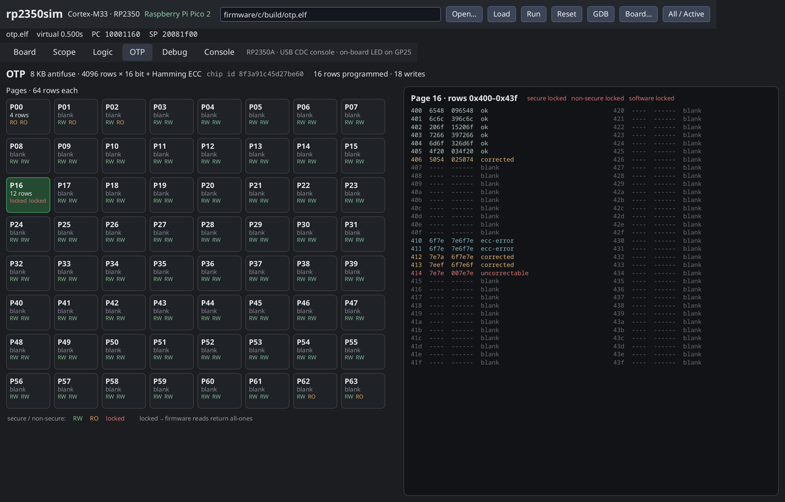
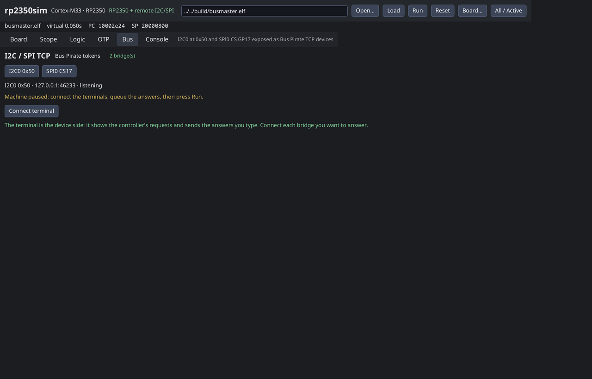

# Peripherals from the CLI and the UI

Every emulated peripheral is reachable from both surfaces:

- the **headless runner** (`rp2350sim`), driven by flags and a firmware image;
- the **desktop UI** (`rp2350sim-ui`), driven by the selected board definition
  and its tabs.

The table below is the quick map. The sections that follow give the exact
commands and UI steps; the register-level wiring lives in
[boards.md](boards.md), and the complete flag list in [cli.md](cli.md).

| Peripheral | Headless runner | UI board key / tab | Reference firmware |
|---|---|---|---|
| GPIO, PWM, ADC | `-trace-pins`, `-logic-pins` | Board, Scope | `blinky`, `pico-examples` |
| UART0/1 | console, `-serial-tcp`, `-logic-uart` | `serial`, Console, Logic | `uart`, `serialbridge` |
| SPI0/1 | `-logic-spi` | Logic | `protocols` |
| I2C0/1 | `-i2c-tcp`, `-logic-i2c` | `i2c_tcp`, Bus, Logic | `busmaster` |
| PIO | `-logic-pins`, `-continue-after-halt` | Logic, Scope | `piotest`, `ws2812` |
| USB CDC | `-input`, `-stdin`, `-expect` | Console | `echo` |
| DMA, timers, watchdog | no user flag | no tab | `pico-examples` |
| ST7789 LCD | `-lcd`, `-touch-lcd2`, `-lcd-png` | `lcd`, LCD | `lcd`, `touchlcd` |
| CST816D touch | `-touch-lcd2`, `-touch` | `touch`, LCD, Sensors | `touchlcd` |
| QMI8658 IMU | `-touch-lcd2`, `-sensors` | `imu`, Sensors | `touchlcd` |
| Battery monitor | `-touch-lcd2`, `-sensors` | `battery`, Sensors | `touchlcd` |
| microSD / FAT16 | `-sd`, `-sd-dir`, `-sd-image` | `sd`, Sensors | `sdcard` |
| W5500 Ethernet | `-eth` | `ethernet: w5500`, Ethernet | `w5500` |
| W6300 Ethernet | `-w6300` | `ethernet: w6300`, Ethernet | `w6300` |
| CH9120 Ethernet | `-ch9120` | `ethernet: ch9120`, Ethernet | `ch9120` |
| Virtual Wi-Fi | `-ch9120` transport | `wifi`, Wi-Fi | `wifi` |
| WS2812B strip | `-ws2812 GPIO` | `ws2812`, LEDs | `ws2812` |
| QSPI PSRAM | `-psram 8 -psram-latency 6` | `psram`, Board status | `firmware/c/psram` |
| OTP fuses | `-otp`, `-otp-dump` | OTP | `firmware/c/otp` |
| Flash / OTA | `-flash`, `-flash-out` | `--flash`, Board banner | `firmware/c/ota` |
| Logic analyzer | `-logic-*` | Logic | `protocols` |
| Oscilloscope | power trace + `pincheck` | Scope | `pico2-analog` |
| Bus Pirate target | `-i2c-tcp`, `-spi-tcp` | `i2c_tcp` / `spi_tcp`, Bus | `busmaster`, `busdevice` |

Build the demo firmware once with:

```sh
task firmware:blinky firmware:lcd firmware:touchlcd firmware:piotest \
  firmware:ws2812 firmware:w5500 firmware:w6300 firmware:ch9120 firmware:wifi \
  firmware:protocols firmware:serialbridge firmware:busmaster firmware:busdevice \
  firmware:cores firmware:sdcard
```

## GPIO, PWM and ADC

**Headless.** `-trace-pins 25,15` logs every level change as a `slog` record.
For a real waveform, capture raw samples and measure them:

```sh
rp2350sim -fw build/blinky.elf -seconds 2 \
  -logic-pins 25 -logic-rate 1e3 -logic-board pico2 -logic-out blink.txt
pincheck -pin 25 -freq 2 -min-edges 4 blink.txt
```

PWM is a GPIO with a hardware duty cycle: `task run:blinky` checks the LED,
and the pinned pico-examples PWM test uses the same `pincheck` mechanism for
frequency and duty cycle. ADC channels are read by firmware normally; on the
Touch-LCD-2 the battery divider is on GP28/ADC2.

**UI.** The **Board** tab shows the live GPIO table (function, direction,
level). Click header pins in the **Scope** to add or remove traces:
GP0–GP15 and GP26–GP29, 1 MHz sampling, up to eight channels. The
`pico2-analog` board drives a 1 kHz sine on GP26 so the scope and the ADC have
a known signal.

Reference boards: `pico2`, `pico2-analog`. Tasks: `task run:blinky`,
`task ui:scope`.

## UART

**Headless.** UART0 is part of the firmware console and goes to stdout.
Expose either UART as a TCP server:

```sh
rp2350sim -fw build/serialbridge.elf -seconds 30 \
  -serial-tcp 1:127.0.0.1:0
# stderr: msg="uart bridge listening" uart=1 addr=127.0.0.1:39479
nc 127.0.0.1 39479
```

The format is `uart:host:port`, repeatable and comma-separated. Port `0`
picks a free port and logs it. Bytes written to the socket enter the UART RX
FIFO; firmware TX returns on the same connection. Connect promptly: virtual
time runs fast, so use `task ui:serial` for an interactive session.

`-logic-uart tx[,rx],baud` decodes a pin trace. Hardware UART traffic is also
tapped automatically in the logic trace.

**UI.** Add a `serial` entry to a board and connect with `nc`; the assigned
address is listed in the **Console** tab and stays stable across firmware
resets. The **Logic** tab decodes UART frames with the board's
`logic.uart` pins. Reference board: `pico2-serial`; task: `task ui:serial`.

## SPI and I2C buses

**Headless.** There is no generic "attach a chip on SPI" flag: real devices get
their own flag (`-lcd`, `-sd`, `-eth`, `-w6300`). To observe arbitrary traffic,
decode the pins:

```sh
rp2350sim -fw build/protocols.elf -seconds 0.5 \
  -logic-pins 18,19,16,17,4,5 \
  -logic-spi 18,19,16,17 -logic-i2c 4,5 \
  -logic-out protocols.txt
```

`-logic-spi SCK,MOSI[,MISO[,CS]]` and `-logic-i2c SDA,SCL` use the same
decoders as the UI. To make an external program act as the target instead, use
the [Bus Pirate bridges](#bus-pirate-i2c-and-spi-targets).

**UI.** The **Logic** tab synthesises waveforms from the controller models
(no pin-rate sampling needed) and falls back to pin decoding for PIO or
bit-banged traffic. The **Bus** tab is the device side of the bridge. Devices
may share an I2C bus when their addresses differ, and an SPI bus when their
chip selects differ; a duplicate address or `bus`/`cs` pair is rejected when
the board loads.

Reference boards: `pico2-analog`, `pico2-bus`. Task: `task ui:logic`.

## PIO

The PIO0/1/2 interpreter runs state machines per cycle. Firmware that starts a
PIO engine and returns from `main` halts the core while the engine keeps
running; add `-continue-after-halt` so the capture remains valid (it implies
`-allow-halt`).

**Headless.**

```sh
rp2350sim -fw build/piotest.elf -seconds 0.3
rp2350sim -fw build/ws2812.elf -seconds 1.7 -ws2812 0
```

**UI.** PIO output appears on the **Scope**; bit-banged protocols are decoded
by the **Logic** tab from pin traces. Reference firmware: `piotest`, `ws2812`.

## USB CDC console

**Headless.** USB CDC and UART0 share the console. Send input with `-input`,
`-input-file` or `-stdin`; assert output with `-expect` and
`-stop-on-expect`:

```sh
printf 'hello\r' | rp2350sim -fw build/echo.elf -seconds 1 -stdin
```

**UI.** The **Console** tab shows USB CDC + UART output. Click it to focus,
then type; Enter, Backspace, Tab and the arrow keys reach the firmware. UART
bridges and Bus Pirate status lines are listed in the same tab.

## ST7789 LCD

**Headless.** Two wirings exist:

```sh
# RP2350-GEEK / pico2-lcd wiring: SPI1, CS GP9, DC GP8, RST GP12
rp2350sim -fw build/lcd.elf -seconds 1 -lcd -lcd-png lcd.png

# Touch-LCD-2: SPI0, CS GP17, DC GP16, RST GP20, rotated 90°
rp2350sim -fw build/touchlcd.elf -seconds 1 -touch-lcd2 -lcd-png touch.png
```

**UI.** The **LCD** tab renders the framebuffer at panel resolution. Boards
declare `lcd` with `spi`, `cs`, `dc`, `rst`, `width`, `height`, `rotation` and
an optional `backlight` pin. Clicking or dragging the panel injects a touch on
boards that also declare `touch`; the UI maps the rotated view back to native
panel coordinates.


Reference boards: `geek`, `pico2-lcd`, `touch-lcd2`. Tasks: `task lcd`,
`task ui:lcd`, `task ui:touchlcd`.

## Touch, IMU and battery

**Headless.** Use `-touch-lcd2`, then inject a deterministic tap and print the
sensor state:

```sh
rp2350sim -fw build/touchlcd.elf -seconds 3 -touch-lcd2 \
  -touch 120,200 -touch-at 1s -touch-hold 500ms -sensors
```

`-touch` uses native panel coordinates; `-touch-at`/`-touch-hold` place the
down event in virtual time. `-sensors` logs the last touch, acceleration,
temperature, card size and the battery/backlight values at exit.

**UI.** The **Sensors** tab shows the live touch point (X, Y, contact), QMI8658
acceleration/rate and die temperature, battery voltage with the ADC raw value
and divider, PWM backlight duty and card size. The card state is read-only;
inject touches by clicking or dragging the **LCD** panel.



Reference board: `touch-lcd2`. Task: `task ui:touchlcd`.

## microSD and FAT16

**Headless.** `-sd` attaches the GEEK-wiring card; `-touch-lcd2` includes the
Touch-LCD-2 card. Back it with a host directory or a raw image:

```sh
rp2350sim -fw build/sdcard.elf -seconds 4 \
  -sd -sd-dir build/sdcard-host
```

A directory is packed into FAT16 at startup and firmware writes are mirrored
back after they settle (~50 ms of virtual time). Files the firmware deletes
are removed from the host directory; host files that were never on the card
are not deleted, and symlinks are skipped. `-sd-dir` and `-sd-image` are
mutually exclusive; without either, a built-in FAT16 card is used.

**UI.** Boards use `sd: {spi, cs, dir}` (or `image`). The **Sensors** tab shows
the card size and source directory. Distributed boards use `sdcards/geek` and
`sdcards/touch-lcd2` relative to the UI's working directory. Firmware writes
sync back on the next interval; host edits are picked up on the next start.

Reference board: `geek`, `touch-lcd2`. Task: `task run:sdcard`.

## Ethernet: W5500, W6300 and CH9120

All three modules proxy sockets to the host network stack, so the firmware can
reach servers running on this machine.

**Headless.**

```sh
# W5500 or W6300 on SPI0 CS GP17
build/ethhost &
rp2350sim -fw build/w5500.elf -seconds 4 -eth
rp2350sim -fw build/w6300.elf -seconds 4 -w6300

# CH9120 UART-to-Ethernet on UART1 (GP20/21), CFG0 GP18, RST GP19, TCPCS GP17
rp2350sim -fw build/ch9120.elf -seconds 2 -ch9120
```

`-eth` and `-w6300` are mutually exclusive. The runner logs each state change:

```json
{"msg":"network","status":"W5500 ip=10.0.2.15 ... tcp/9002 listen host=127.0.0.1:9002 guest=10.0.2.15:9002"}
```

`host=` is the address to connect to from this machine; the guest IP is an
emulated identity, not a host route. The summary JSON contains the same data
under `network`.

**UI.** The **Ethernet** or **Wi-Fi** tab shows the guest identity, one row per
socket with the reachable host address, and a live device log.



Reference boards: `pico2-w5500`, `poe-eth`, `rp2350-eth`. Tasks:
`task run:w5500`, `task run:w6300`, `task run:ch9120`.

## Virtual Wi-Fi (Pico 2 W)

The Pico 2 W board is **not** a CYW43439 emulation. It attaches the same
host-backed serial netdev through the CH9120 transport, and firmware uses
`drivers/ch9120.NetDevice` plus `netdev.UseNetdev` to get TinyGo's `net`
package. Bluetooth is not modelled.

**Headless.** `firmware/wifi` uses the CH9120 transport:

```sh
build/ethhost &
rp2350sim -fw build/wifi.elf -seconds 3 -ch9120
```

**UI.** The `pico2w` board shows the same socket state under **Wi-Fi**; the
firmware prints `wifi echo: hello wifi`.


Reference board: `pico2w`. Task: `task ui:wifi`.

## WS2812B

**Headless.** `-ws2812 GPIO` decodes the wire timing (GRB, T0H/T1H split,
reset gap) into colours:

```sh
rp2350sim -fw build/ws2812.elf -seconds 1.7 -ws2812 0
```

**UI.** The **LEDs** tab paints the last latched frame as swatches with their
hex values. Boards declare `ws2812: {pin}`.


Reference board: `pico2-ws2812`. Task: `task ui:ws2812`.

## QSPI PSRAM

**Headless.** Attach the optional QMI chip-select-1 device with `-psram`; the
size is in MiB and `-psram-latency` is the extra virtual time per access:

```sh
rp2350sim -fw firmware/c/build/psram.elf -seconds 2 \
  -psram 8 -psram-cs 8 -psram-latency 6 \
  -expect 'psram: ok' -stop-on-expect
```

The Pico SDK sees the device through boot RAM `FLASH_DEVINFO`, so
`psram_is_available()` and `psram_get_size()` work; window 1 stays read-only
until the SDK sets `XIP_CTRL.WRITABLE_M1`. `-psram-latency 0` makes it
SRAM-fast, while higher values slow the virtual clock for every access (timers
and DMA see the stall too). Accesses past the configured size are reported as
unmapped.

**UI.** The `pico2-psram` board declares `psram: {size_mb: 8, cs: 8, latency:
6}`; the Board status line shows `PSRAM 8 MB · 6 cyc`. `task ui:psram` loads
the C demo.



Reference firmware: `firmware/c/psram`. Tasks: `task c:psram`,
`task ui:psram`.

## OTP fuses

**Headless.** The OTP array is 4096 rows of 24 bits with fuse semantics and
Hamming ECC. Seed it and dump the result as JSON:

```sh
rp2350sim -fw firmware/c/build/otp.elf -seconds 0.3 \
  -otp-dump otp.json -expect "OTP demo: ok" -stop-on-expect
rp2350sim -fw firmware/c/build/otp.elf -seconds 0.3 -otp otp.json
```

Rows with `raw` are restored verbatim (corrupted ECC round-trips); rows with
only `data` get fresh ECC.

**UI.** The **OTP** tab shows 64 pages of 64 rows, programmed counts and the
effective secure/non-secure and software locks. Click a page to inspect data,
raw 24-bit values and ECC status. It follows the last programmed row until you
pick a page. The UI has no OTP seed flag: use the runner to create a dump, or
run the C OTP example to populate it.



Reference firmware: `firmware/c/otp`. Task: `task c:otp`.

## Flash and OTA

**Headless.** `-flash PATH` loads a raw 16 MiB image and writes it back after a
reset and at exit; `-flash-out PATH` only writes the final image. A single flat
slot is modelled (no A/B rollback).

```sh
rp2350sim -fw firmware/c/build/ota.elf -flash build/ota.bin -seconds 2 \
  -expect "ota v2 running" -stop-on-expect
rp2350sim -flash build/ota.bin -seconds 0.2 -quiet
```

**UI.** Pass `--flash` to persist self-updates. After a reset the **Board**
tab shows a banner naming the flash image, its boot number and entry point;
the status line changes the ELF name to `(flash)`. `task ui:ota` and
`task ui:ota-png` run/render the demo.

Reference firmware: `firmware/c/ota`. Task: `task c:ota`.

## Logic analyzer

**Headless.** Capture hardware UART/SPI/I2C taps, raw pin samples, or both:

```sh
rp2350sim -fw build/protocols.elf -seconds 0.5 \
  -logic-pins 0,1,4,5,18,19,16,17 \
  -logic-uart 0,1,115200 -logic-i2c 4,5 \
  -logic-spi 18,19,16,17 -logic-out trace.txt
```

`-logic-rate` sets the sample rate (2 MHz default) and `-logic-depth` the ring
depth (16384). Without `-logic-out` the file is
`logic-analyze-trace-<date>-<board>.txt` in the current directory; set the
board name with `-logic-board`. Capturing pins installs a per-cycle hook and
disables idle fast-forward.

**UI.** The **Logic** tab shows synthesised waveforms, decoded UART/I2C/SPI/USB
sections and a **Save trace** button that writes the same text format (with a
USB CDC section as well).


Reference board: `pico2-analog`. Task: `task ui:logic`.

## Oscilloscope

There is no headless oscilloscope. Use `-trace-pins`/`-logic-pins` for edges
and `tools/pincheck` for frequency/duty measurements.

The UI **Scope** has up to eight channels, each with its own colour, 1 MHz
sampling and a ~16 ms window. Click header pins to add or remove traces; the
legend shows the latest voltage. **Time Zoom** changes the window from 1× to
64×, **Range** selects 0.5, 1, 1.65, 2, 3.3 or 5 V full scale, and **Reset**
restores 1×/3.3 V. `analog:` board entries drive generated sine, square or
triangle sources.


Reference board: `pico2-analog`. Task: `task ui:scope`.

## Bus Pirate I2C and SPI targets

The token reference, transcripts and fake-peripheral recipes are in
[bus-pirate.md](bus-pirate.md). The summary here is the peripheral guide.

**Headless.** `-i2c-tcp` and `-spi-tcp` expose the controller to an external
program acting as the device. The wire format is Bus Pirate tokens:

```text
I2C: [0xA0 → ACK, 0x00 → ACK, [0xA1 r:1 → 0x12, r:1 → 0x34, ] 
SPI: [0x9F → 0xEF, 0x9F → 0x40, 0x9F → 0x18, ]
```

```sh
# listen: a script connects
rp2350sim -fw build/busmaster.elf -seconds 5 \
  -i2c-tcp 0:0x50@127.0.0.1:0 -spi-tcp 0:17@127.0.0.1:0

# connect: the emulator dials a device server
rp2350sim -fw build/busmaster.elf -seconds 5 \
  -i2c-tcp 0:0x50=127.0.0.1:9000 -spi-tcp 0:17=127.0.0.1:9001
```

The address byte is `addr << 1`. `-bus-timeout` (1 s) bounds a request;
`-bus-wait` (2 s) waits once for the first client, then a missing client
NAKs/returns `0xff`. `tools/busfake` is a ready-made EEPROM/JEDEC device.

**UI.** The **Bus** tab lists the bridges. Select one, press **Connect
terminal**, queue `ACK`/`NAK`/hex tokens, then run the firmware. Each bridge
keeps its own terminal. The UI timeout is 500 ms, so `task ui:bus` starts
paused: connect both terminals, queue the answers, then press **Run**.
**Reset firmware** restarts the current image after queueing.



Reference boards: `pico2-bus`; firmware `busmaster` and `busdevice`. Tasks:
`task ui:bus`, `task ui:bus:png`.

## Board-to-flag map

| UI board | Headless flags | Task |
|---|---|---|
| `pico2` | none | `task ui:blinky` |
| `pico2-lcd` | `-lcd` | `task ui:lcd` |
| `pico2-ws2812` | `-ws2812 0` | `task ui:ws2812` |
| `pico2-psram` | `-psram 8 -psram-cs 8 -psram-latency 6` | `task ui:psram` |
| `geek` | `-lcd -sd -sd-dir build/sdcard-host` | `task ui:lcd`, `task run:sdcard` |
| `touch-lcd2` | `-touch-lcd2 -touch x,y` | `task ui:touchlcd` |
| `pico2-w5500` | `-eth` | `task ui:w5500` |
| `poe-eth` | `-w6300` | `task ui:w6300` |
| `rp2350-eth` | `-ch9120` | `task ui:ch9120` |
| `pico2w` | `-ch9120` (Wi-Fi transport) | `task ui:wifi` |
| `pico2-serial` | `-serial-tcp 1:127.0.0.1:0` | `task ui:serial` |
| `pico2-bus` | `-i2c-tcp`, `-spi-tcp` | `task ui:bus` |
| `pico2-analog` | `-logic-pins`, `-logic-uart`, `-logic-i2c`, `-logic-spi` | `task ui:scope`, `task ui:logic` |

See [ui.md](ui.md) for the UI controls and [boards.md](boards.md) for wiring.
