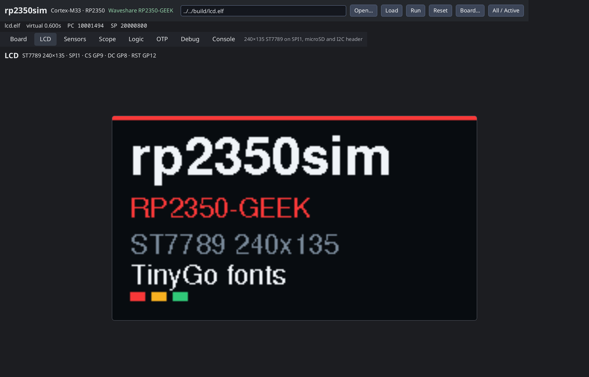
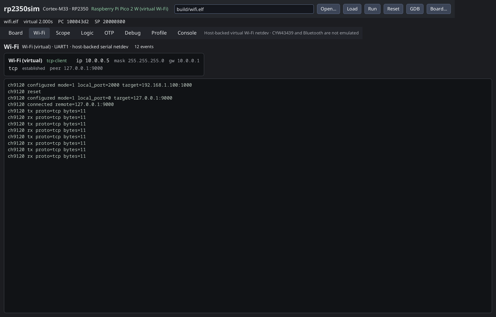
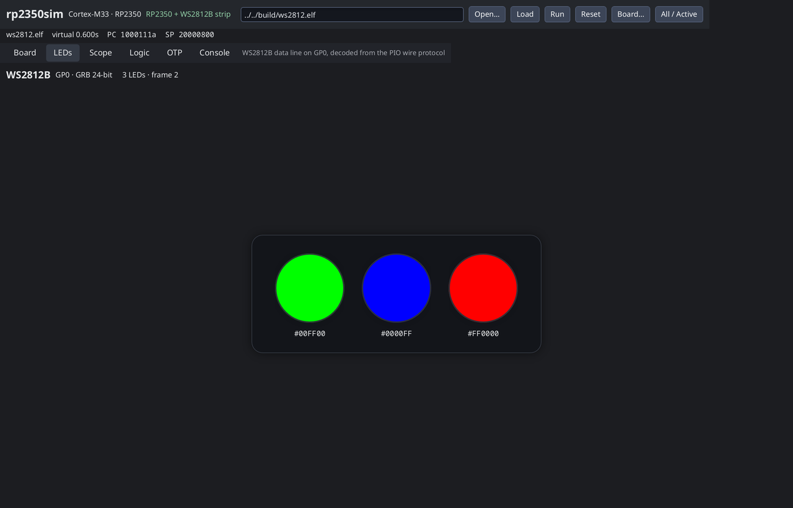
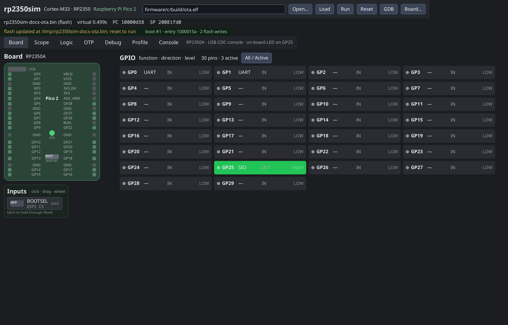
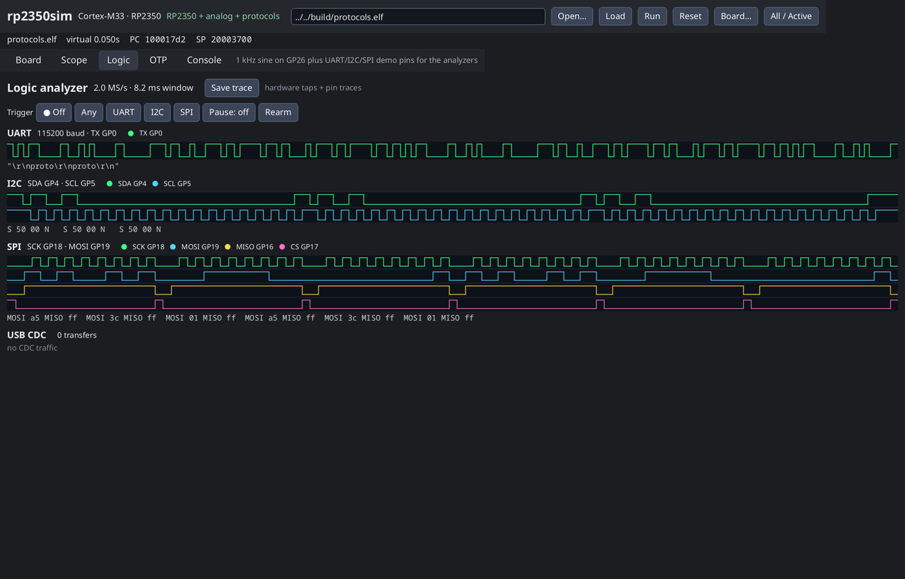
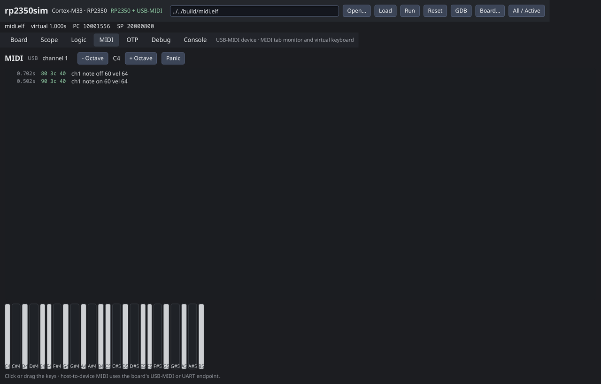
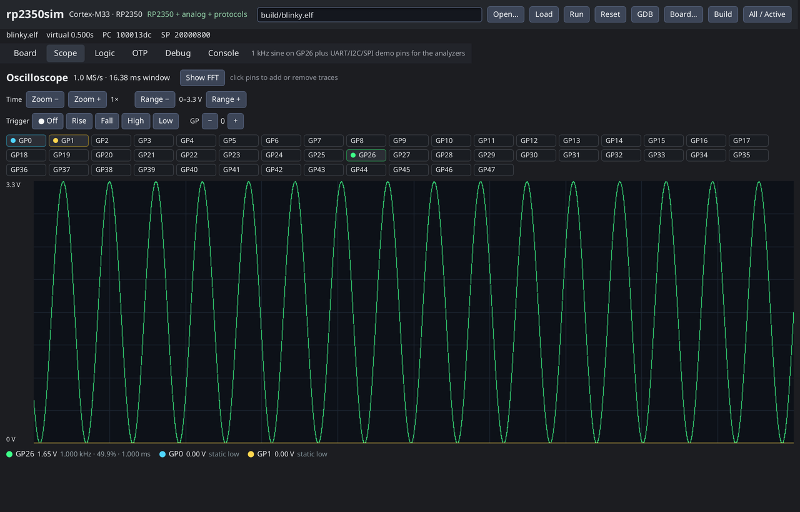
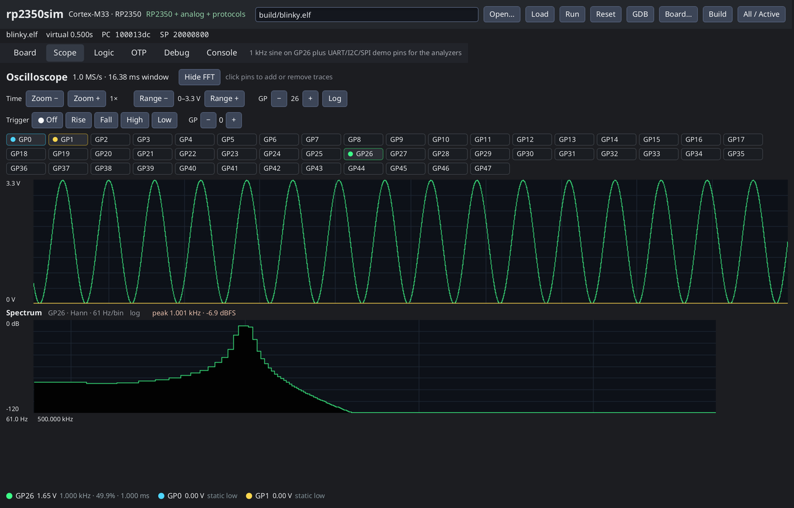

# Peripherals from the CLI and the UI

Every emulated peripheral is reachable from both surfaces:

- the **headless runner** (`rp2350sim`), driven by flags and a firmware image;
- the **desktop UI** (`rp2350sim-ui`), driven by the selected board definition
  and its tabs.

The table below is the quick map. The sections that follow give the exact
commands and UI steps; the register-level wiring lives in
[boards.md](boards.md), and the complete flag list in [cli.md](cli.md).

| Peripheral | Headless runner | UI board key / tab | Reference firmware |
|---|---|---|---|
| GPIO, PWM, ADC | `-trace-pins`, `-logic-pins` | Board, Scope | `blinky`, `pico-examples` |
| UART0/1 | console, `-serial-tcp`, `-logic-uart` | `serial`, Console, Logic | `uart`, `serialbridge` |
| SPI0/1 | `-logic-spi` | Logic | `protocols` |
| I2C0/1 | `-i2c-tcp`, `-i2c-preset`, `-logic-i2c` | `i2c_tcp` / `i2c_presets`, Bus, Logic | `busmaster`, `presets` |
| PIO | `-logic-pins`, `-continue-after-halt` | Logic, Scope | `piotest`, `ws2812` |
| USB CDC (TinyGo, TinyUSB) | `-input`, `-stdin`, `-expect` | Console | `echo`, `firmware/c/usbhello` |
| USB-MIDI / UART MIDI | `-usb-midi`, `-midi-uart`, `-midi-udp` | `midi`, MIDI | `midi` |
| USB HID (keyboard/mouse/gamepad) | `-usb-hid`, `-hid-out` | `hid` | `hid`, `hidgamepad` |
| Audio (I2S/PDM/PWM) | `-audio-*`, `-audio-out` | `audio`, Audio | `audio` |
| HSTX / DVI | `-dvi-png` | `hstx`, DVI | pico-examples DVI |
| RP2350B QFN-80 | `-rp2350b` | `package: qfn80` | `pico-examples` |
| TRNG / SHA-256 | no user flag | no tab | pico-examples `rand`, `sha256` |
| POWMAN AON timer | no user flag | no tab | `firmware/c/aontimer` |
| GDB remote | `-gdb ADDR` | Debug, toolbar GDB | any ELF |
| DMA, timers, watchdog | no user flag | no tab | `pico-examples` |
| ST7789 LCD | `-lcd`, `-touch-lcd2`, `-lcd-png` | `lcd`, LCD | `lcd`, `touchlcd` |
| CST816D touch | `-touch-lcd2`, `-touch` | `touch`, LCD, Sensors | `touchlcd` |
| QMI8658 IMU | `-touch-lcd2`, `-sensors` | `imu`, Sensors | `touchlcd` |
| Battery monitor | `-touch-lcd2`, `-sensors` | `battery`, Sensors | `touchlcd` |
| microSD / FAT16 | `-sd`, `-sd-dir`, `-sd-image` | `sd`, Sensors | `sdcard` |
| W5500 Ethernet | `-eth` | `ethernet: w5500`, Ethernet | `w5500` |
| W6300 Ethernet | `-w6300` | `ethernet: w6300`, Ethernet | `w6300` |
| CH9120 Ethernet | `-ch9120` | `ethernet: ch9120`, Ethernet | `ch9120` |
| Virtual Wi-Fi | `-ch9120` transport | `wifi`, Wi-Fi | `wifi` |
| WS2812B strip | `-ws2812 GPIO` | `ws2812`, LEDs | `ws2812` |
| QSPI PSRAM | `-psram 8 -psram-latency 6` | `psram`, Board status | `firmware/c/psram` |
| OTP fuses | `-otp`, `-otp-dump` | OTP | `firmware/c/otp` |
| Flash / OTA, A/B slots | `-flash`, `-flash-out` | `--flash`, Board banner | `firmware/c/ota` |
| Logic analyzer | `-logic-*` | Logic | `protocols` |
| Oscilloscope | power trace + `pincheck` | Scope | `pico2-analog` |
| Bus Pirate target | `-i2c-tcp`, `-spi-tcp` | `i2c_tcp` / `spi_tcp`, Bus | `busmaster`, `busdevice` |
| Built-in bus presets | `-i2c-preset`, `-spi-preset`, `-list-presets` | `i2c_presets` / `spi_presets`, Bus | `presets` |
| Scripted I2C/SPI/UART devices | `-i2c-plugin`, `-spi-plugin`, `-uart-plugin` | `i2c_plugins` / `spi_plugins` / `serial_plugins`, Bus and Console | `plugins/examples` |
| 1-Wire DS18B20 | `-onewire PIN[:C]` | `onewire`, Board | `onewire` |
| DHT11/DHT22 | `-dht PIN[:KIND[:HUM[:TEMP]]]` | `dht`, Board | `dht` |
| HC-SR04 ultrasonic | `-ultrasonic TRIG:ECHO[:CM]` | `ultrasonic`, Board | `ultrasonic` |
| GPS / NMEA 0183 | `-gps UART[:LAT:LON]` | `gps`, Board and Console | `gps` |
| CAN 2.0B / MCP2515 | `-can CS[:INT[:PEER_ID]]` | `can`, Board and Console | `can` |
| ITM / DWT trace | `-itm` | Debug / CLI trace | `firmware/c/itmdemo` |

Build the demo firmware once with:

```sh
task firmware:blinky firmware:lcd firmware:touchlcd firmware:piotest \
  firmware:ws2812 firmware:w5500 firmware:w6300 firmware:ch9120 firmware:wifi \
  firmware:protocols firmware:serialbridge firmware:busmaster firmware:busdevice \
  firmware:presets firmware:cores firmware:sdcard firmware:audio firmware:midi
```

## GPIO, PWM and ADC

**Headless.** `-trace-pins 25,15` logs every level change as a `slog` record.
For a real waveform, capture raw samples and measure them:

```sh
rp2350sim -fw build/blinky.elf -seconds 2 \
  -logic-pins 25 -logic-rate 1e3 -logic-board pico2 -logic-out blink.txt
pincheck -pin 25 -freq 2 -min-edges 4 blink.txt
```

PWM is a GPIO with a hardware duty cycle: `task run:blinky` checks the LED,
and the pinned pico-examples PWM test uses the same `pincheck` mechanism for
frequency and duty cycle. ADC inputs are GP26–GP29 on RP2350A and GP40–GP47 on
RP2350B, with temperature on channel 4 or 8 respectively. On the Touch-LCD-2 the
battery divider is on GP28/ADC2.

**UI.** The **Board** tab shows the live GPIO view (function, direction,
level) as uniform fixed-width Cards. The **Scope** pin picker offers every GPIO
(GP0–GP47; RP2350A packages bond GP0–29), uses width-aware rows so all pins fit
inside the window, and supports 1 MHz sampling with up to eight channels. The
`pico2-analog` board drives a 1 kHz sine on GP26 so the scope and the ADC have
a known signal.

The **Board** tab can also host virtual controls declared in `boards.yaml`:
pushbuttons, slide switches, rotary encoders, ADC pots/sliders and BOOTSEL.
`task ui:inputs` opens the `pico2-inputs` demo; see [ui.md](ui.md#board-inputs).

Reference boards: `pico2`, `pico2-analog`, `pico2-inputs`. Tasks:
`task run:blinky`, `task ui:scope`, `task ui:inputs`.

## UART

**Headless.** UART0 is part of the firmware console and goes to stdout.
Expose either UART as a TCP server:

```sh
rp2350sim -fw build/serialbridge.elf -seconds 30 \
  -serial-tcp 1:127.0.0.1:0
# stderr: msg="uart bridge listening" uart=1 addr=127.0.0.1:39479
nc 127.0.0.1 39479
```

The format is `uart:host:port`, repeatable and comma-separated. Port `0`
picks a free port and logs it. Bytes written to the socket enter the UART RX
FIFO; firmware TX returns on the same connection. Connect promptly: virtual
time runs fast, so use `task ui:serial` for an interactive session.

`-logic-uart tx[,rx],baud` decodes a pin trace. Hardware UART traffic is also
tapped automatically in the logic trace. A Lua/WASM `serial_plugins` entry (or
`-uart-plugin`) can act as the device on a UART, with `uart_tx`/`uart_send`
for request/response framing; see [device plugins](plugins.md).

**UI.** Add a `serial` entry to a board and connect with `nc`; the assigned
address is listed in the **Console** tab and stays stable across firmware
resets. The **Logic** tab decodes UART frames with the board's
`logic.uart` pins. Reference board: `pico2-serial`; task: `task ui:serial`.

## SPI and I2C buses

**Headless.** There is no generic "attach a chip on SPI" flag: real devices get
their own flag (`-lcd`, `-sd`, `-eth`, `-w6300`). To observe arbitrary traffic,
decode the pins:

```sh
rp2350sim -fw build/protocols.elf -seconds 0.5 \
  -logic-pins 18,19,16,17,4,5 \
  -logic-spi 18,19,16,17 -logic-i2c 4,5 \
  -logic-out protocols.txt
```

`-logic-spi SCK,MOSI[,MISO[,CS]]` and `-logic-i2c SDA,SCL` use the same
decoders as the UI. To make an external program act as the target instead, use
the [Bus Pirate bridges](#bus-pirate-i2c-and-spi-targets), or attach a Lua/WASM
`i2c_plugins`/`spi_plugins` model with `-i2c-plugin`/`-spi-plugin`; see
[device plugins](plugins.md).

**UI.** The **Logic** tab synthesises waveforms from the controller models
(no pin-rate sampling needed) and falls back to pin decoding for PIO or
bit-banged traffic. The **Bus** tab is the device side of the bridge. Devices
may share an I2C bus when their addresses differ, and an SPI bus when their
chip selects differ; a duplicate address or `bus`/`cs` pair is rejected when
the board loads.

Reference boards: `pico2-analog`, `pico2-bus`. Task: `task ui:logic`.

## PIO

The PIO0/1/2 interpreter runs state machines per cycle. Firmware that starts a
PIO engine and returns from `main` halts the core while the engine keeps
running; add `-continue-after-halt` so the capture remains valid (it implies
`-allow-halt`).

**Headless.**

```sh
rp2350sim -fw build/piotest.elf -seconds 0.3
rp2350sim -fw build/ws2812.elf -seconds 1.7 -ws2812 0
```

**UI.** PIO output appears on the **Scope**; bit-banged protocols are decoded
by the **Logic** tab from pin traces. Reference firmware: `piotest`, `ws2812`.

## USB CDC console

**Headless.** USB CDC and UART0 share the console. Send input with `-input`,
`-input-file` or `-stdin`; assert output with `-expect` and
`-stop-on-expect`:

```sh
printf 'hello\r' | rp2350sim -fw build/echo.elf -seconds 1 -stdin
```

Both the TinyGo CDC console and stock Pico SDK TinyUSB CDC stdio work. The
emulated host follows the configuration descriptor, the DPRAM buffer addresses
in `EP_CONTROL`, the control status stage and host OUT data PIDs.

**UI.** The **Console** tab shows USB CDC + UART output. Click it to focus,
then type; Enter, Backspace, Tab and the arrow keys reach the firmware. UART0
receives input immediately; USB bytes wait until CDC is enumerated and its OUT
endpoint is armed. UART bridges and Bus Pirate status lines are listed in the
same tab.


Reference firmware: `echo` (TinyGo), `firmware/c/usbhello` and
`firmware/c/usbecho` (TinyUSB). Tasks: `task ui`, `task c:usbhello`,
`task c:usbecho`.

## ST7789 LCD

**Headless.** Two wirings exist:

```sh
# RP2350-GEEK / pico2-lcd wiring: SPI1, CS GP9, DC GP8, RST GP12
rp2350sim -fw build/lcd.elf -seconds 1 -lcd -lcd-png lcd.png

# Touch-LCD-2: SPI0, CS GP17, DC GP16, RST GP20, rotated 90°
rp2350sim -fw build/touchlcd.elf -seconds 1 -touch-lcd2 -lcd-png touch.png
```

**UI.** The **LCD** tab renders the framebuffer at panel resolution. Boards
declare `lcd` with `spi`, `cs`, `dc`, `rst`, `width`, `height`, `rotation` and
an optional `backlight` pin. Clicking or dragging the panel injects a touch on
boards that also declare `touch`; the UI maps the rotated view back to native
panel coordinates.



Reference boards: `geek`, `pico2-lcd`, `touch-lcd2`. Tasks: `task lcd`,
`task ui:lcd`, `task ui:touchlcd`.

## Touch, IMU and battery

**Headless.** Use `-touch-lcd2`, then inject a deterministic tap and print the
sensor state:

```sh
rp2350sim -fw build/touchlcd.elf -seconds 3 -touch-lcd2 \
  -touch 120,200 -touch-at 1s -touch-hold 500ms -sensors
```

`-touch` uses native panel coordinates; `-touch-at`/`-touch-hold` place the
down event in virtual time. `-sensors` logs the last touch, acceleration,
temperature, card size and the battery/backlight values at exit.

**UI.** The **Sensors** tab shows the live touch point (X, Y, contact), QMI8658
acceleration/rate and die temperature, battery voltage with the ADC raw value
and divider, PWM backlight duty and card size. The card state is read-only;
inject touches by clicking or dragging the **LCD** panel.


Reference board: `touch-lcd2`. Task: `task ui:touchlcd`.

## HSTX and DVI

**Headless.** The HSTX command expander and TMDS encoder are decoded into a
framebuffer. `-dvi-png PATH` writes the last complete frame:

```sh
rp2350sim -fw build/pico-examples/build/dvi_out_hstx_encoder/dvi_out_hstx_encoder.elf \
  -seconds 0.5 -dvi-png dvi.png
```

The reference firmware is the stock pico-examples `hstx/dvi_out_hstx_encoder`
(640×480 RGB332 on GP12–19); `task picoexamples:build` builds it. Frames are
captured at the active width; the height is inferred from the common DVI modes
(640×480, 320×240, 800×600, 1280×720). RAW/RAW_REPEAT and TMDS/TMDS_REPEAT
commands, including multi-word counts and repeat rotation, are expanded. Serial
TMDS output timing is not modelled.

**UI.** The `pico2-dvi` board enables the **DVI** tab, which shows the last
frame and offers **Save PNG**. `task ui:dvi` opens it; `task ui:dvi:png`
renders it headlessly.


## microSD and FAT16

**Headless.** `-sd` attaches the GEEK-wiring card; `-touch-lcd2` includes the
Touch-LCD-2 card. Back it with a host directory or a raw image:

```sh
rp2350sim -fw build/sdcard.elf -seconds 4 \
  -sd -sd-dir build/sdcard-host
```

A directory is packed into FAT16 at startup and firmware writes are mirrored
back after they settle (~50 ms of virtual time). Files the firmware deletes
are removed from the host directory; host files that were never on the card
are not deleted, and symlinks are skipped. `-sd-dir` and `-sd-image` are
mutually exclusive; without either, a built-in FAT16 card is used.

**UI.** Boards use `sd: {spi, cs, dir}` (or `image`). The **Sensors** tab shows
the card size and source directory. Distributed boards use `sdcards/geek` and
`sdcards/touch-lcd2` relative to the UI's working directory. Firmware writes
sync back on the next interval; host edits are picked up on the next start.

Reference board: `geek`, `touch-lcd2`. Task: `task run:sdcard`.

## Ethernet: W5500, W6300 and CH9120

All three modules proxy sockets to the host network stack, so the firmware can
reach servers running on this machine.

**Headless.**

```sh
# W5500 or W6300 on SPI0 CS GP17
build/ethhost &
rp2350sim -fw build/w5500.elf -seconds 4 -eth
rp2350sim -fw build/w6300.elf -seconds 4 -w6300

# CH9120 UART-to-Ethernet on UART1 (GP20/21), CFG0 GP18, RST GP19, TCPCS GP17
rp2350sim -fw build/ch9120.elf -seconds 2 -ch9120
```

`-eth` and `-w6300` are mutually exclusive. The runner logs each state change:

```json
{"msg":"network","status":"W5500 ip=10.0.2.15 ... tcp/9002 listen host=127.0.0.1:9002 guest=10.0.2.15:9002"}
```

`host=` is the address to connect to from this machine; the guest IP is an
emulated identity, not a host route. The summary JSON contains the same data
under `network`.

W5500/W6300 sockets support TCP client/server and UDP client/server. A UDP
client binds the guest `Sn_PORT` as its host source port; a UDP server binds it
on the first `RECV` (or `LISTEN`). Received datagrams include the WIZnet 8-byte
peer header, matching the chip; `drivers/w6300` strips it on receive. TCP
listeners bind the host wildcard so another machine can connect; use the
advertised `host=` address.

**UI.** The **Ethernet** or **Wi-Fi** tab shows the guest identity, one row per
socket with the reachable host address, and a live device log.


Reference boards: `pico2-w5500`, `poe-eth`, `rp2350-eth`. Tasks:
`task run:w5500`, `task run:w6300`, `task run:ch9120`.

## Virtual Wi-Fi (Pico 2 W)

The Pico 2 W board is **not** a CYW43439 emulation. It attaches the same
host-backed serial netdev through the CH9120 transport, and firmware uses
`drivers/ch9120.NetDevice` plus `netdev.UseNetdev` to get TinyGo's `net`
package. Bluetooth is not modelled.

**Headless.** `firmware/wifi` uses the CH9120 transport:

```sh
build/ethhost &
rp2350sim -fw build/wifi.elf -seconds 3 -ch9120
```

**UI.** The `pico2w` board shows the same socket state under **Wi-Fi**; the
firmware prints `wifi echo: hello wifi`.



Reference board: `pico2w`. Task: `task ui:wifi`.

## WS2812B

**Headless.** `-ws2812 GPIO` decodes the wire timing (GRB, T0H/T1H split,
reset gap) into colours:

```sh
rp2350sim -fw build/ws2812.elf -seconds 1.7 -ws2812 0
```

**UI.** The **LEDs** tab paints the last latched frame as swatches with their
hex values. Boards declare `ws2812: {pin}`.



Reference board: `pico2-ws2812`. Task: `task ui:ws2812`.

## QSPI PSRAM

**Headless.** Attach the optional QMI chip-select-1 device with `-psram`; the
size is in MiB and `-psram-latency` is the extra virtual time per access:

```sh
rp2350sim -fw firmware/c/build/psram.elf -seconds 2 \
  -psram 8 -psram-cs 8 -psram-latency 6 \
  -expect 'psram: ok' -stop-on-expect
```

The Pico SDK sees the device through boot RAM `FLASH_DEVINFO`, so
`psram_is_available()` and `psram_get_size()` work; window 1 stays read-only
until the SDK sets `XIP_CTRL.WRITABLE_M1`. `-psram-latency 0` makes it
SRAM-fast, while higher values slow the virtual clock for every access (timers
and DMA see the stall too). Accesses past the configured size are reported as
unmapped.

**UI.** The `pico2-psram` board declares `psram: {size_mb: 8, cs: 8, latency:
6}`; the Board status line shows `PSRAM 8 MB · 6 cyc`. `task ui:psram` loads
the C demo.


Reference firmware: `firmware/c/psram`. Tasks: `task c:psram`,
`task ui:psram`.

## RP2350B (QFN-80)

**Headless.** `-rp2350b` models the QFN-80 package: SYSINFO reports package
select 0 and the pin model exposes GP0–GP47. PIO `GPIOBASE` 0/16 gives its
32-pin window access to GP32–47.

**UI.** Set `package: qfn80` in `boards.yaml`; the `pico2b` board does this.
The Board tab and GPIO table list all 48 pins, and the scope offers GP0–GP47.
Pass `--board pico2b` (or select it in the picker).


The RP2350A default remains 30 GPIOs; `rp2350sim -rp2350b` is the headless
equivalent. See [boards.md](boards.md#rp2350b-qfn-80) for the package limits.

## OTP fuses

**Headless.** The OTP array is 4096 rows of 24 bits with fuse semantics and
Hamming ECC. Seed it and dump the result as JSON:

```sh
rp2350sim -fw firmware/c/build/otp.elf -seconds 0.3 \
  -otp-dump otp.json -expect "OTP demo: ok" -stop-on-expect
rp2350sim -fw firmware/c/build/otp.elf -seconds 0.3 -otp otp.json
```

Rows with `raw` are restored verbatim (corrupted ECC round-trips); rows with
only `data` get fresh ECC.

**UI.** The **OTP** tab shows 64 pages of 64 rows, programmed counts and the
effective secure/non-secure and software locks. Click a page to inspect data,
raw 24-bit values and ECC status. It follows the last programmed row until you
pick a page. The UI has no OTP seed flag: use the runner to create a dump, or
run the C OTP example to populate it.


Reference firmware: `firmware/c/otp`. Task: `task c:otp`.

## TRNG, SHA-256 and the AON timer

The RP2350 crypto and always-on blocks are functional; they have no UI tab, so
the runner console is the interface:

```sh
# SHA-256 vector + 1 MB NIST test, with and without DMA
rp2350sim -fw build/pico-examples/build/sha256/hello_sha256.elf \
  -seconds 3 -expect Success -stop-on-expect

# pico_rand distribution test through the TRNG
rp2350sim -fw build/pico-examples/build/rand/rand.elf \
  -seconds 3 -expect 'All done' -stop-on-expect

# POWMAN 1 kHz timer, alarm and IRQ 45 through pico_aon_timer
rp2350sim -fw firmware/c/build/aontimer.elf -seconds 2 \
  -expect 'aon alarm 1001' -stop-on-expect
```

The TRNG produces deterministic EHR words from a seeded stream; reading the
last EHR word starts a new 192-bit sample. SHA-256 supports word, halfword and
byte WDATA writes (including DMA_SIZE_8), BSWAP and SUM0–7. POWMAN models the
millisecond counter, set/read time, alarm and timer interrupt; deep-sleep power
sequencing is not modelled.

Reference firmware: pico-examples `sha/sha256` and `system/rand`,
`firmware/c/aontimer`. Tasks: `task c:aontimer`, `task picoexamples:build`.

## Flash and OTA

**Headless.** `-flash PATH` loads a raw 16 MiB image and writes it back after a
reset and at exit; `-flash-out PATH` only writes the final image. A flat image
is the default; a raw image may carry the emulator's PT25 A/B partition table
(see [cli.md](cli.md)). Signed picobin tables and rollback policy are not
parsed.

```sh
rp2350sim -fw firmware/c/build/ota.elf -flash build/ota.bin -seconds 2 \
  -expect "ota v2 running" -stop-on-expect
rp2350sim -flash build/ota.bin -seconds 0.2 -quiet
```

**UI.** Pass `--flash` to load and persist a raw backing image. When a firmware
file is also supplied, the backing image is restored first and the firmware
segments are applied over it; a missing backing file starts erased. After a
reset the **Board** tab shows a banner naming the flash image, its boot number
and entry point; the status line changes the ELF name to `(flash)`. `task ui:ota` and
`task ui:ota-png` run/render the demo.



Raw flash images can also carry the PT25 A/B table: the bootrom-style loader
picks the highest-version executable slot, or the active/preferred one, maps
its storage into the `0x10000000` window, and `rom_reboot(FLASH_UPDATE)`
prefers the slot just written for exactly one boot. See [cli.md](cli.md#flash-and-self-update).

Reference firmware: `firmware/c/ota`. Task: `task c:ota`.

## Logic analyzer

**Headless.** Capture hardware UART/SPI/I2C taps, raw pin samples, or both:

```sh
rp2350sim -fw build/protocols.elf -seconds 0.5 \
  -logic-pins 0,1,4,5,18,19,16,17 \
  -logic-uart 0,1,115200 -logic-i2c 4,5 \
  -logic-spi 18,19,16,17 -logic-out trace.txt
```

`-logic-rate` sets the sample rate (2 MHz default) and `-logic-depth` the ring
depth (16384). Without `-logic-out` the file is
`logic-analyze-trace-<date>-<board>.txt` in the current directory; set the
board name with `-logic-board`. The text includes complete UART/SPI/I2C tap
logs for every bus. `-vcd PATH` writes the digital pin window as an IEEE 1364
value change dump for GTKWave or PulseView. Capturing pins installs a periodic
sampler on the requested grid, which keeps idle fast-forward available.

**UI.** The **Logic** tab shows synthesised waveforms, decoded UART/I2C/SPI/USB
sections and **Save trace**/**Save VCD** buttons. Save trace writes the same
text format (with a USB CDC section and full event logs); Save VCD writes
`logic-trace-<date>-<board>.vcd`.



Reference board: `pico2-analog`. Task: `task ui:logic`.

## Audio

GPIO/PWM audio, I2S and PDM can be decoded into a WAV file, and the UI can
play the capture. The decoder samples pins on every emulated cycle, so it
needs no firmware support.

**Headless.** Exactly one source, plus `-audio-out`:

```sh
rp2350sim -fw build/audio.elf -seconds 1 -audio-pwm 0 -audio-out tone.wav
rp2350sim -fw fw.elf -seconds 2 -audio-i2s 4,5,6,16 -audio-out i2s.wav
rp2350sim -fw fw.elf -seconds 2 -audio-pdm 6,7,64 -audio-out mic.wav
```

`-audio-pwm` averages the pin's high time over one output sample period, which
works for both hardware PWM (the duty becomes the sample) and a plain GPIO
square wave (TinyGo's `time.Sleep` toggle). A disabled PWM slice parks at the
low rail, so its raw capture is DC; UI playback removes that offset. I2S
decodes Philips framing with 16/24/32-bit slots; PDM averages one bit density
over the decimation window.
`-audio-rate` sets the output rate (48 kHz default). `tools/wavcheck` asserts
the rate, channels, RMS and fundamental frequency in CI:

```sh
tools/wavcheck -rate 48000 -channels 1 -freq 440 -freq-tol 30 -min-rms 0.1 tone.wav
```

**UI.** The **Audio** tab shows the capture as a waveform with **Save WAV**,
**Play** and **Stop**. Playback removes the DC offset and applies fixed
headroom before handing the file to a host player: a decoded GPIO square wave
is full scale, and a pin parked high is pure DC, which can damage speakers or
hearing at system volume. The saved WAV is the unmodified capture.


Reference board: `pico2-audio`; firmware `audio`. Tasks: `task run:audio`
(headless WAV), `task audio:test` (CI assertion), `task ui:audio`.

## MIDI

USB-MIDI (TinyGo `machine/usb/adc/midi`) and 31250-baud UART MIDI are
supported headlessly and in the UI.

**Headless.** `-usb-midi` enables the class endpoint; `-midi-uart` taps a UART;
`-midi-monitor` logs parsed messages; `-midi-udp` exposes a bidirectional
UDP-MIDI endpoint.

```sh
rp2350sim -fw build/midi.elf -seconds 5 -usb-midi -midi-monitor \
  -midi-udp 127.0.0.1:5004
```

A datagram of raw MIDI bytes is parsed (running status included) and delivered
to the firmware on endpoint 3 or the UART receive FIFO. Firmware messages are
logged and sent back to the last UDP sender. The UART tap watches TX only, so
an echo firmware cannot feed itself. When both `-usb-midi` and `-midi-uart` are
set, host messages are delivered to both transports. The emulated host accepts
the composite CDC+MIDI descriptor (`descriptor.CDCMIDI`) and enumerates endpoint
3 alongside the CDC console. System Exclusive (`F0`..`F7`) is not reassembled
or forwarded; the monitor reports the parsed channel and system messages only.

**UI.** The **MIDI** tab lists messages newest first with raw bytes and cycle
time, and provides a two-octave piano keyboard across the full panel width
with octave buttons and **Panic** (Note Off for held keys plus All Notes Off
on all channels). A key sends Note On on press and Note Off on release;
clicking or dragging plays a glissando, and keys the firmware plays light up.
Board changes flush those release messages to the old endpoint before switch.



Reference boards: `pico2-midi` (USB) and `pico2-midi-uart`; firmware `midi`.
Tasks: `task run:midi`, `task run:midi:uart`, `task ui:midi`,
`task ui:midi:uart`.

## USB HID

The emulated host enumerates USB HID keyboard, mouse and gamepad interfaces,
follows the configuration descriptor for interrupt endpoints, fetches the HID
report descriptor and sends `SET_IDLE`. Reports are decoded from that descriptor,
so composite devices (for example TinyGo's keyboard + mouse + media descriptor)
and custom gamepad layouts work without a hardcoded report format.

**Headless.** `-usb-hid` logs every decoded report; `-hid-out HEX` sends one
host-to-device output report once the interrupt OUT endpoint is armed (keyboard
LEDs are `02 01` for NumLock in TinyGo's descriptor).

```sh
rp2350sim -fw build/hid.elf -seconds 3 -usb-hid
rp2350sim -fw build/hid.elf -seconds 3 -usb-hid -hid-out 0201
rp2350sim -fw build/hidgamepad.elf -seconds 3 -usb-hid
```

Reports appear as `kind=keyboard|mouse|gamepad` with decoded text (`keys=A`,
`buttons=left dx=12`, `buttons=1 hat=right x=-12000`) and raw hex. The host
supports multiple HID interfaces and report IDs; the descriptor request uses the
class-specific length from the HID descriptor. `-bootsel` holds QSPI CS low,
which pico-sdk's HID composite example uses as its report trigger.

**UI.** The **HID** tab appears once an interface enumerates. It lists reports
newest first, shows the interface endpoints, and offers keyboard LED toggles plus
a generic output-report hex field for gamepad feedback. The firmware is the USB
device; the emulator is the host, so the monitor shows device-to-host reports and
the controls send host-to-device output reports.

Full page: [USB HID](hid.md).

Reference firmware: `hid` (TinyGo keyboard + mouse), `hidgamepad` (TinyGo
joystick). Tasks: `task run:hid`, `task run:hidgamepad`,
`task ui:hid`, `task ui:hidgamepad`, and `task ui:hid:composite` for pico-sdk's
keyboard/mouse/media/gamepad example (BOOTSEL latched). `task ui:hid:png`
renders the tab headlessly to `build/ui-hid.png`.

## Oscilloscope

There is no headless oscilloscope. Use `-trace-pins`/`-logic-pins` for edges
and `tools/pincheck` for frequency/duty measurements.

The UI **Scope** has up to eight channels, each with its own colour, 1 MHz
sampling and a ~16 ms window. Any GPIO 0–47 can be added (RP2350A packages
only bond 0–29). The legend shows the latest voltage and live
frequency/duty/period readouts via the same edge measurement as `pincheck`.
**Trigger** supports Off/Rise/Fall/High/Low on a chosen GPIO; the trigger pin
is added to the channels if it is not already selected. A match freezes the
window with a quarter of post-trigger data and marks the trigger instant.
**Time Zoom** changes the window from 1× to 64×, **Range** selects 0.5, 1, 1.65,
2, 3.3 or 5 V full scale, and **Reset** restores 1×/3.3 V. `analog:` board
entries drive generated sine, square or triangle sources.

**Show FFT** adds a Hann-windowed, one-sided real FFT of the visible window below
the time trace; the button toggles to **Hide FFT**. The display is dBFS (the
selected range is 0 dB), defaults to a log frequency axis with a Log/Lin toggle,
and shows the selected channel and interpolated peak. With multiple channels the
GP −/+ selector chooses the analyzed trace. `--fft` starts with the spectrum
shown for headless renders.





Reference board: `pico2-analog`. Tasks: `task ui:scope`,
`task ui:scope:fft`, `task ui:scope:png`, `task ui:scope:fft:png`.

## Bus Pirate I2C and SPI targets

The token reference, transcripts and fake-peripheral recipes are in
[bus-pirate.md](bus-pirate.md). The summary here is the peripheral guide.

**Built-in presets.** `-i2c-preset` and `-spi-preset` attach an embedded
device model directly, with no external process: `bme280`, `ssd1306`,
`mpu6050` (I2C) and `w25q16` (SPI). `-list-presets` prints the registry. For
example:

```sh
rp2350sim -fw build/blinky.elf -seconds 2 \
  -i2c-preset 0:bme280@0x76 -i2c-preset 0:mpu6050@0x68 \
  -spi-preset 0:w25q16@17
```

**Headless.** `-i2c-tcp` and `-spi-tcp` expose the controller to an external
program acting as the device. The wire format is Bus Pirate tokens:

```text
I2C: [0xA0 → ACK, 0x00 → ACK, [0xA1 r:1 → 0x12, r:1 → 0x34, ] 
SPI: [0x9F → 0xEF, 0x9F → 0x40, 0x9F → 0x18, ]
```

```sh
# listen: a script connects
rp2350sim -fw build/busmaster.elf -seconds 5 \
  -i2c-tcp 0:0x50@127.0.0.1:0 -spi-tcp 0:17@127.0.0.1:0

# connect: the emulator dials a device server
rp2350sim -fw build/busmaster.elf -seconds 5 \
  -i2c-tcp 0:0x50=127.0.0.1:9000 -spi-tcp 0:17=127.0.0.1:9001
```

The address byte is `addr << 1`. `-bus-timeout` (1 s) bounds a request;
`-bus-wait` (2 s) waits once for the first client, then a missing client
NAKs/returns `0xff`. `tools/busfake` is a ready-made EEPROM/JEDEC device.

The demo `firmware/presets` probes all four models; `task run:presets` prints
each result. **UI.** The **Bus** tab lists built-in presets and TCP bridges. A board with
`i2c_presets`/`spi_presets` (for example `pico2-presets`) shows the attached
models and needs no terminal. For a bridge, select it, press **Connect
terminal**, queue `ACK`/`NAK`/hex tokens, then run the firmware. Each bridge
keeps its own terminal. The UI timeout is 500 ms, so `task ui:bus` starts
paused: connect both terminals, queue the answers, then press **Run**.
**Reset firmware** restarts the current image after queueing.


Reference boards: `pico2-bus`; firmware `busmaster` and `busdevice`. Tasks:
`task ui:bus`, `task ui:bus:png`.

## Scripted I2C, SPI and UART devices

A device model can be a `.lua` script or a compiled `.wasm` file. The Lua
interpreter is bundled as WebAssembly and both formats run under wazero, so the
same board works on the desktop, in the runner and in the browser. The full
model, ABI, examples and limits are in [plugins.md](plugins.md).

```sh
rp2350sim -fw build/presets.elf -seconds 1   -i2c-plugin 0:0x76=plugins/examples/bme280.lua   -spi-plugin 0:17=plugins/examples/w25q16.lua   -uart-plugin 1=plugins/examples/uart-modem.lua
```

In a board:

```yaml
i2c_plugins:
  - { bus: 0, addr: 0x76, file: plugins/examples/bme280.lua }
spi_plugins:
  - { bus: 0, cs: 17, file: plugins/examples/w25q16.lua }
serial_plugins:
  - { uart: 1, file: plugins/examples/uart-modem.lua }
```

The **Bus** tab lists loaded plugin instances and their `print`/`host_log`
output, so a script's debug lines are visible without a separate console. The
CLI writes the same lines as `plugin` log records. `pico2-plugins` is a
ready-made board; `task ui:plugins` opens it.

## 1-Wire and DS18B20

A DS18B20 can be attached to any GPIO with a bit-banged or PIO 1-Wire master.
The model implements reset/presence, Skip ROM, Read ROM, Convert T and Read
Scratchpad with the Dallas CRC8; timing runs on the virtual clock.

```sh
rp2350sim -fw build/onewire.elf -seconds 2 -onewire 6:22.5
```

```yaml
onewire:
  - { pin: 6, type: ds18b20, temperature: 22.5 }
```

`type` defaults to `ds18b20`; `temperature` is in Celsius. The reference
firmware is `firmware/onewire`, and `task run:onewire` runs it with a 22.5 °C
sensor on GP6. The board `pico2-onewire` is the UI equivalent.

## DHT11/DHT22 and HC-SR04

Both use the same timed-wire layer as 1-Wire. The DHT model answers the 1 ms
start pulse with the 40-bit frame; the HC-SR04 drives echo high for
`distance_cm * 58 us`.

```sh
rp2350sim -fw build/dht.elf -seconds 2 -dht 6:dht22:45:23
rp2350sim -fw build/ultrasonic.elf -seconds 2 -ultrasonic 6:7:100
```

```yaml
dht:
  - { pin: 6, kind: dht22, humidity: 45, temperature: 23 }
ultrasonic:
  - { trig: 6, echo: 7, distance_cm: 100 }
```

Reference firmware: `firmware/dht`, `firmware/ultrasonic`; boards
`pico2-dht` and `pico2-ultrasonic`; tasks `run:dht` and `run:ultrasonic`.

## GPS and NMEA 0183

The GPS model emits GGA and RMC sentences on a hardware UART receive FIFO,
with valid NMEA checksums. Position, altitude, speed, course, satellites and
fix state are configurable; the time advances deterministically.

```sh
rp2350sim -fw build/gps.elf -seconds 2 -gps 1
```

```yaml
gps:
  uart: 1
  lat: 45.5017
  lon: -73.5673
  altitude: 82
  speed_knots: 3.2
  course: 270
  satellites: 9
  rate_ms: 1000
```

Reference firmware: `firmware/gps`; board `pico2-gps`; task `run:gps`. The
logic analyzer decodes the UART stream, and the Bus/Console show the firmware's
parsed fix. `ParseNMEA` in `internal/devices` validates checksums and is shared
with map/UI work.

## CAN / MCP2515

An MCP2515 SPI controller is attached to a small in-process CAN bus with one
responding peer. The controller model implements reset, register read/write,
TX/RX buffers, RTS, status and bit-modify, and an optional active-low INT pin.

```sh
rp2350sim -fw build/can.elf -seconds 2 -can 17:20:0x123
```

```yaml
can:
  bus: 0
  cs: 17
  int: 20
  peer_id: 0x123
  reply_id: 0x124
```

The peer answers a request frame by incrementing each data byte. This is
classic CAN 2.0B; CAN FD needs an MCP2518FD-class controller and is a separate
model. Reference firmware: `firmware/can`; board `pico2-can`; task `run:can`.

## ITM and DWT trace

Cortex-M33 ITM stimulus writes and the DWT cycle/PC registers are modelled.
`-itm` prints stimulus bytes to stdout; DWT `CYCCNT` follows the virtual clock
and `PCSR` returns the current PC.

```sh
rp2350sim -fw firmware/c/build/itmdemo.elf -seconds 1 -quiet -itm
```

The C fixture writes a string to ITM stimulus port 0 without UART or USB
stdio. The chip exposes the same events through `Chip.OnTrace` for future UI
work; SWO pin decoding is a separate follow-up.

## Board-to-flag map

| UI board | Headless flags | Task |
|---|---|---|
| `pico2` | none | `task ui:blinky` |
| `pico2-lcd` | `-lcd` | `task ui:lcd` |
| `pico2-ws2812` | `-ws2812 0` | `task ui:ws2812` |
| `pico2-psram` | `-psram 8 -psram-cs 8 -psram-latency 6` | `task ui:psram` |
| `geek` | `-lcd -sd -sd-dir build/sdcard-host` | `task ui:lcd`, `task run:sdcard` |
| `touch-lcd2` | `-touch-lcd2 -touch x,y` | `task ui:touchlcd` |
| `pico2-dvi` | `-dvi-png PATH` | `task ui:dvi`, `task ui:dvi:png` |
| `pico2b` | `-rp2350b` | — (48-GPIO package) |
| `pico2-w5500` | `-eth` | `task ui:w5500` |
| `poe-eth` | `-w6300` | `task ui:w6300` |
| `rp2350-eth` | `-ch9120` | `task ui:ch9120` |
| `pico2w` | `-ch9120` (Wi-Fi transport) | `task ui:wifi` |
| `pico2-serial` | `-serial-tcp 1:127.0.0.1:0` | `task ui:serial` |
| `pico2-bus` | `-i2c-tcp`, `-spi-tcp` | `task ui:bus` |
| `pico2-presets` | `-i2c-preset`, `-spi-preset` | — (built-in models) |
| `pico2-plugins` | `-i2c-plugin`, `-spi-plugin`, `-uart-plugin` | `task ui:plugins`, `task wasm:plugins` |
| `pico2-onewire` | `-onewire 6` | `task run:onewire` |
| `pico2-dht` | `-dht 6` | `task run:dht` |
| `pico2-ultrasonic` | `-ultrasonic 6:7` | `task run:ultrasonic` |
| `pico2-gps` | `-gps 1` | `task run:gps` |
| `pico2-can` | `-can 17:20` | `task run:can` |
| `pico2-analog` | `-logic-pins`, `-logic-uart`, `-logic-i2c`, `-logic-spi` | `task ui:scope`, `task ui:logic` |
| `pico2-audio` | `-audio-pwm 0 -audio-out PATH` | `task run:audio`, `task ui:audio` |
| `pico2-midi` | `-usb-midi -midi-monitor` | `task run:midi`, `task ui:midi` |
| `pico2-midi-uart` | `-midi-uart 1 -midi-monitor` | `task run:midi:uart`, `task ui:midi:uart` |

See [ui.md](ui.md) for the UI controls and [boards.md](boards.md) for wiring.
