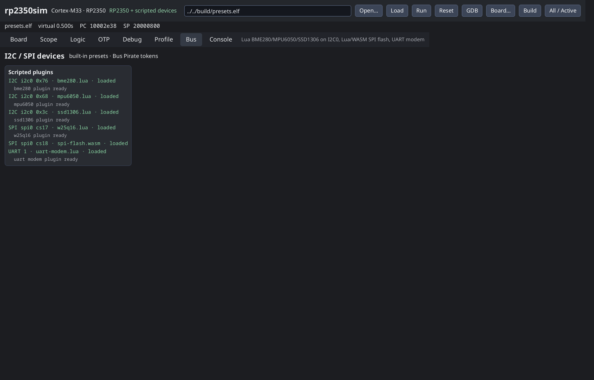

# Scripted and compiled device plugins

A device model can be a file instead of Go code that has to be compiled into
the emulator. Two formats are supported:

- **Lua** (`.lua`) runs inside a bundled Lua 5.4 interpreter compiled to
  WebAssembly;
- **WASM** (`.wasm`) runs directly.

Both use the same small bus ABI and the same host runtime (`wazero`), so a
model behaves the same on the desktop, in the headless runner and in the
browser demo. This is how the four built-in presets grow into a device
ecosystem: anyone can share a BME280, a flash chip, a modem or a companion
radio as a file.



## Quick start

The built-in `pico2-plugins` board loads the Lua examples and a compiled WASM
flash:

```sh
task ui:plugins
# or
rp2350sim-ui --board pico2-plugins --tab bus build/presets.elf
```

The embedded `pico2-plugins` demo resolves its `file:` paths relative to
`cmd/simui` (where the UI module runs), so use the tasks from a checkout; the
browser variant uses the `url:` fields instead.

From a board YAML file:

```yaml
i2c_plugins:
  - { bus: 0, addr: 0x76, file: plugins/examples/bme280.lua }
spi_plugins:
  - { bus: 0, cs: 17, file: plugins/examples/w25q16.lua }
serial_plugins:
  - { uart: 1, file: plugins/examples/uart-modem.lua }
```

The complete schema, `file`/`url` rules and conflict validation are in the
[boards.yaml reference](boards-yaml.md#i2c_plugins-spi_plugins-and-serial_plugins).

From the headless runner:

```sh
rp2350sim -fw build/presets.elf -seconds 1 \
  -i2c-plugin 0:0x76=plugins/examples/bme280.lua \
  -spi-plugin 0:17=plugins/examples/w25q16.lua \
  -uart-plugin 1=plugins/examples/uart-modem.lua
```

```text
-i2c-plugin  bus:addr=path
-spi-plugin  bus:cs=path
-uart-plugin uart=path
```

## The Lua runtime

Users do not need a Lua or C toolchain. `device_lua.wasm` is checked into the
repository and embedded in both binaries; a `.lua` file is the only file the
user ships.

The interpreter is built from Lua 5.4.7 with `wasi-sdk` as C++ using the wasm
exception-handling proposal (Lua raises through `longjmp`). `scripts/plugins/build.sh`
owns the build and `internal/deviceplugin/assets/device_lua.wasm` is the
artifact. The interpreter is a reactor: the host calls its exports and the
script is data.

A Lua plugin returns a table with a `new(config)` constructor. The constructed
table uses colon methods:

```lua
return {
  new = function(config)
    local d = { ptr = 0, first = true, regs = {} }
    d.regs[0xD0] = 0x60 -- chip id

    function d:i2c_begin(addr) d.first = true end
    function d:i2c_write(b)
      if d.first then d.ptr = b; d.first = false
      else d.regs[d.ptr] = b; d.ptr = (d.ptr + 1) % 256 end
      return true -- ACK
    end
    function d:i2c_read()
      local v = d.regs[d.ptr] or 0
      d.ptr = (d.ptr + 1) % 256
      return v, true
    end
    function d:i2c_end() end

    -- SPI plugins implement spi_select(active) and spi_transfer(tx)
    -- UART plugins implement uart_tx(b)
    -- d:tick(us) and d:reset() are optional
    return d
  end,
}
```

Optional methods:

| method | meaning |
|---|---|
| `i2c_begin(addr)` / `i2c_write(b)->ack` / `i2c_read()->byte,ack` / `i2c_end()` | I2C target; return `false` or `nil` to NAK |
| `spi_select(active)` / `spi_transfer(tx)->byte` | SPI target, called on every CS edge and byte |
| `uart_tx(b)` | firmware byte; answer with `uart_send("...")` |
| `tick(us)` | virtual-time callback (1 ms grid) |
| `reset()` | chip/reset hook |

Lua helpers available to a plugin:

```lua
print("...")           -- a log line
uart_send("OK\r\n")    -- bytes back to the firmware UART
gpio_write(pin, true)  -- drive a configured line (IRQ, reset, ...)
gpio_read(pin)         -- read a configured line
now_us()               -- virtual time
```

`config` is passed as a Lua table. It is the `config:` mapping from
`boards.yaml` (or empty). Lua tables, strings, numbers and booleans are
supported.

The standard libraries are limited to `base`, `table`, `string`, `math`,
`utf8` and `coroutine`; `io`, `os`, `package` and `debug` are not available.

## Compiled WASM plugins

A `.wasm` plugin implements the same ABI directly. It must export:

```text
plugin_abi_version() -> i32        // 1
plugin_alloc(size) -> ptr
plugin_init(config_ptr, config_len) -> i32 // 0 ok
plugin_reset()
plugin_tick(us: i64)

i2c_begin(addr) / i2c_write(b)->i32 / i2c_read()->i32 / i2c_end()
spi_select(active) / spi_transfer(tx)->i32
uart_tx(b)
```

and may import from `plugin`:

```text
host_log(ptr, len)
host_now_us() -> i64
host_gpio_write(pin, level) -> i32
host_gpio_read(pin) -> i32
host_uart_send(ptr, len) -> i32
```

`i2c_read` returns `-1` for NAK. `plugin_init` receives JSON config bytes.
A minimal SPI example is in `plugins/examples/wasm/spi-flash.c`; the compiled
`plugins/examples/spi-flash.wasm` is attached by the `pico2-plugins` board
alongside the Lua models.

## Watching plugin output

Plugin `print()` (and WASM `host_log`) lines appear in the **Bus** tab's
Scripted plugins card, with the instance, slot and load state. The CLI writes
the same lines as `plugin` `slog` records, so `-quiet` still leaves warnings
and errors visible. This is the first place to look when a script fails to
parse or a constructor throws.

## Serial companions

A UART plugin receives every byte the firmware writes and can inject bytes
back with `uart_send`. It is enough to mock a serial companion such as an
nRF5340 host interface or a modem: keep a receive buffer in the script,
implement the framing and command/response set, and use `tick` for
unsolicited events. `plugins/examples/uart-modem.lua` is a small AT-command
example.

nRF7002-class parts use an SPI host interface; use `spi_select`/`spi_transfer`
and `gpio_write` for the IRQ line. The examples are deliberately generic—
implement the protocol subset your firmware and driver actually use.

## Limits

- Plugins are trusted local files. They run in the emulator's process and can
  spend CPU or loop forever; link limits are not a security boundary. Lua
  libraries are still restricted and WASM has no filesystem or network
  imports.
- Lua runs under wazero's interpreter in both desktop and browser builds. The
  browser therefore has a wasm-in-wasm interpreter; use compiled WASM or keep
  transactions modest for high-rate SPI.
- Plan on a reset to re-create plugin state; plugins are attached when the
  chip is built. Board YAML changes require a reload.
- The ABI is versioned (`plugin_abi_version` = 1). An unsupported version or
  missing export is a load error, not a silent default.

## Tasks

```sh
task plugins:build    # rebuild device_lua.wasm (needs wasi-sdk + Lua source)
task ui:plugins       # the pico2-plugins board in the Bus tab
task ui:plugins:png   # render it to build/ui-plugins.png
```

The browser build copies `plugins/examples/` into `build/web/plugins/` so the
same board and URLs work in the [browser demo](wasm.md).
