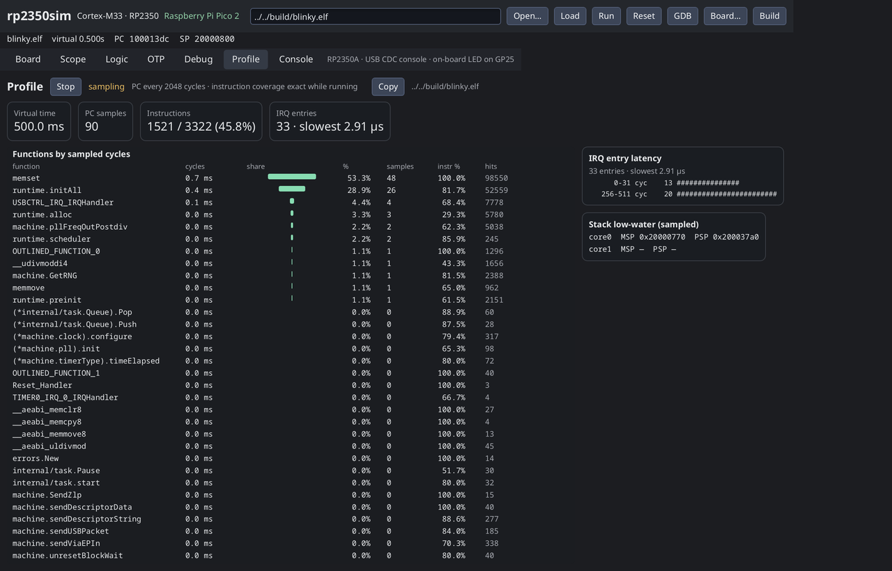

# Profiler and coverage

`rp2350sim` profiles firmware on the emulator's virtual clock. The Profile tab
and the headless flags expose the same data: where sampled cycles go, which
instructions ran, how long interrupts waited, and how deep each stack went.



## What is recorded

Profiling has two independent views plus two health signals:

| View | Source | Use |
|---|---|---|
| **Sampled profile** | one PC sample every 2048 cycles in the UI, 4096 by default on the CLI | cycles per function, flat profile |
| **Exact coverage** | every executed instruction counted | instruction and line coverage, LCOV |
| **IRQ latency** | peripheral/software IRQ pend → handler entry | histogram and slowest entry |
| **Stack watermarks** | MSP and PSP sampled with the PC | lowest stack address per core |

All of it uses virtual time. The same firmware and run length produce the same
report; idle fast-forward simply takes no samples because no code ran.

## Profile tab

**Start** discards the previous run and begins collecting; **Stop** freezes the
report until the next start. `--tab profile` and `--profile` start before the
warm-up, which is useful for screenshots.

The summary shows profiled virtual time, PC samples, executed/static
instructions and instruction coverage, and interrupt entries with the slowest
latency. **Copy** puts the same report — summary, functions, IRQ histogram and
stack watermarks — on the system clipboard as plain text. The function table is
sorted by sampled cycles:

- **cycles** — samples multiplied by the sampling period.
- **share** — bar and percentage of all samples.
- **samples** — raw sample count in that function.
- **instr %** — distinct executed instructions / decoded static instructions.
- **hits** — total instruction executions (the LCOV `FNDA` value).

The right column shows the IRQ latency histogram and the sampled MSP/PSP
low-water marks per core.

### Firmware without DWARF

The tab uses ELF symbols and DWARF when they exist. A UF2/raw image, or the
browser demo's packed tinychess ELF, has none; the Profile tab then says so and
aggregates samples and hits into **256-byte PC buckets** instead of failing.
The address shown is the bucket start, so a hot loop is still obvious.

In the browser, an ELF picked or dropped on the page is parsed in memory and
keeps its symbols and DWARF. See the [browser build](wasm.md).

## Headless profiling

| flag | meaning |
|---|---|
| `-profile` | collect PC samples and exact instruction coverage |
| `-profile-interval N` | PC sampling period in cycles (default 4096) |
| `-coverage PATH` | write an LCOV tracefile at exit |
| `-profile-out PATH` | write the full report as JSON at exit |
| `-profile-top N` | log the N hottest functions at exit |

Any of these flags starts collection. `-profile` alone still enables exact
coverage; the other flags imply it too.

```sh
rp2350sim -fw build/blinky.elf -seconds 1 \
  -profile -coverage build/blinky.info \
  -profile-out build/blinky-profile.json -profile-top 10
```

The exit log has a `profile` record with virtual milliseconds, samples,
executed/total instructions, instruction coverage, IRQ count and slowest
latency. `-profile-top` adds one line per hot function.

### LCOV output

`-coverage` writes a standard LCOV tracefile:

```text
TN:
SF:/path/to/firmware/main.go
FN:18,main
FNDA:2,main
DA:18,2
DA:19,1
LF:2
LH:2
end_of_record
```

- `SF` and `DA` come from DWARF statement rows. Every row is emitted, including
  count zero; the count is instruction hits, not basic-block hits.
- `FN`/`FNDA` use the ELF function symbols and total instruction executions.
- `LF`/`LH` count executable and hit lines for that file.
- Branch coverage (`BRDA`) and function call counts are not modelled.

Firmware without DWARF produces an empty tracefile; use the JSON report or the
Profile tab's PC buckets instead.

### JSON report

`-profile-out` writes the same report as JSON, including:

- `functions`: name, file, line, address, size, static instructions, executed
  instructions, hits, samples and cycles;
- `lines`: per-file/per-line counts;
- totals (`total_instructions`, `executed_instructions`, `total_hits`,
  `total_samples`, `sample_cycles`, `elapsed_cycles`);
- `irq_hist`, `irq_slowest`, `irq_count` and per-core `stack`;
- `symbolized`: false when the function list is the PC-bucket fallback.

## IRQ latency and stacks

Interrupt latency is measured from the moment a peripheral or software IRQ
becomes pending on a core to the entry of that exception. A nested wait is
included. A line that deasserts before entry is not measured. The histogram uses
32-cycle buckets from 32 to 131072 cycles (about 0.2 µs to 0.87 ms at 150 MHz)
plus an overflow bucket; system exceptions such as SysTick, PendSV and SVC are
not included.

MSP and PSP low-water marks are sampled at the PC sampling period, so they show
the deepest stack use seen at a sample, not an exact per-instruction minimum.
They are still useful for spotting a task that nearly overflowed its stack.

## Limits

- Sampling attributes cycles, not exact per-instruction costs; increase the
  sample rate with `-profile-interval` for a finer profile.
- Exact coverage adds a map update per instruction. Use sampling only when the
  overhead matters, and keep exact coverage for short verification runs.
- Code executed by the synthetic bootrom services is Go code and is not
  attributed.
- The profiler is deterministic, but the reported sample count depends on the
  run length and idle fast-forward exactly as the emulator executed it.

## Tasks and tests

```sh
task ui:profile       # Profile tab on blinky
task ui:profile:png   # render to build/ui-profile.png
task run:profile      # headless LCOV + JSON + top functions
```

`internal/coverage` has unit tests for function/line attribution, LCOV output
and the PC-bucket fallback. The smoke suite checks the LCOV and JSON outputs and
the Profile tab snapshot.
