# Desktop UI

`rp2350sim-ui` is a Shirei desktop application that wraps the same emulator as
the headless runner. It starts with a board picker, attaches that board's
devices, and exposes the live machine through tabs: GPIO, LCD, DVI, sensors,
Ethernet, LEDs, sensors, scope, logic analyzer, GPS, CAN, audio, MIDI, HID,
OTP, built-in bus presets, Bus Pirate terminals, the debugger, the ITM trace
and the firmware console. Live reload
(`--watch`) restarts the machine when the firmware file changes on disk.

The UI is a separate Go module (`cmd/simui/`) so GUI dependencies never enter
the emulator build. Download `rp2350sim-ui` from
[GitHub Releases](https://github.com/akhenakh/rp2350sim/releases) and run it:

```sh
rp2350sim-ui --board geek build/lcd.elf
```

The window is 1280×820 by default; `--width`/`--height` change it. **Cmd+Q** on
macOS or **Ctrl+Q** elsewhere quits.

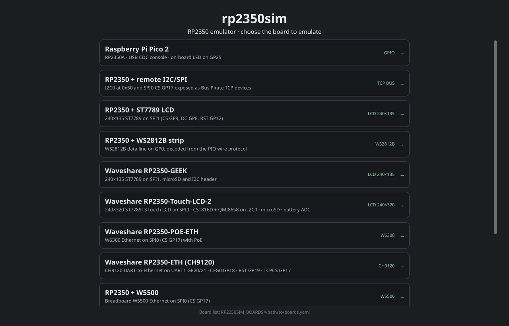

## Startup: the board picker

The picker is a scrollable list loaded from the embedded
`cmd/simui/boards.yaml`. Each card shows the board name, description and device
badges. Selecting one attaches its devices to the emulated chip and builds the
matching tabs; boards without a device do not get that tab.

Override the list without rebuilding:

```sh
RP2350SIM_BOARDS=/path/to/boards.yaml rp2350sim-ui
```

Startup flags:

| flag | meaning |
|---|---|
| `--board ID` | skip the picker and select a board (see `--list-boards`) |
| `--input ID=VALUE` | set a board input before the first frame (`on`/`off`, volts, `+N`/`-N`); repeatable |
| `--list-boards` | print board IDs, names and badges, then exit |
| `--version` | print the version and exit |
| `--tab NAME` | initial tab: `board`, `lcd`, `dvi`, `eth`/`wifi`, `ws`, `sensors`, `scope`, `logic`, `gps`, `can`, `audio`, `midi`, `otp`, `bus`, `debug`, `trace`, `console` |
| `--width`, `--height` | window size in points |
| `--run SECONDS` | advance virtual time at startup; a live window keeps running, `--png` snapshots stay frozen |
| `--turbo` | run as fast as the host allows instead of pacing virtual time to real time |
| `--paused` | load the firmware but do not execute until Run |
| `--png PATH` | render one settled frame and exit (headless) |
| `--flash PATH` | raw flash backing image; loaded before firmware, and self-updates are written back here |
| `--touch x,y` | inject a held touch at native panel coordinates |
| `--touch-demo` | move a synthetic touch around the panel while the UI runs |
| `--scope-zoom N`, `--scope-range V` | initial scope time zoom / full-scale volts |
| `--logic-trigger KIND` | arm the logic analyzer at startup: `off`, `any`, `uart`, `i2c`, `spi` |
| `--logic-pause` | pause the machine when the startup logic trigger fires |
| `--break SPEC` | add a breakpoint (address or symbol) before the first instruction |
| `--gdb ADDR` | start the GDB remote server at launch (the toolbar **GDB** button toggles it) |
| `--debug-tab TAB` | debug inspector tab at startup: `registers`, `memory`, `variables` |
| `--bus-connect` | connect the Bus tab terminal to every bridge listener automatically |
| `--bus-answer KIND=TOKENS` | queue Bus Pirate responses for `i2c` or `spi`; repeatable |
| `--watch` | reload and reset when the firmware (or `--flash` image) changes on disk |

For headless use, `--run` executes synchronously before the frame is rendered
(the UI does not step in the background), and the system font scan is awaited
so labels are present.

## Toolbar and machine lifecycle

The toolbar shows the CPU/board identity, the firmware path, **Open…** (an
in-window file browser with path entry, breadcrumbs, sorting and filters for
`.uf2`/`.elf`/`.bin`), **Load**, **Run**/**Pause**, **Reset**, **GDB**,
**Board…** and the scope controls. The status
line under it reports the image name, virtual time, PC and SP, or `(flash)`
after a self-update.

A live window paces the emulated clock to real time: when the firmware sleeps,
the loop waits instead of racing ahead, and the status line shows the achieved
ratio (`virtual 1.234s · 1.00×`). Firmware the interpreter cannot execute fast
enough shows a ratio below 1× and the virtual time turns red. `--turbo` removes
the pacing and runs as fast as the host allows (the ratio is still shown);
`--png` snapshots always run synchronously and are unaffected.

- **Load** restarts the selected image, useful after a rebuild.
- **Reset** restarts the current image, preserving a self-updated flash.
- **GDB** starts or stops the GDB remote server on `--gdb ADDR` (default
  `127.0.0.1:3333`); the status line shows the listening address while it is
  active. Attach with `arm-none-eabi-gdb` and `target remote`; see
  [debug.md](debug.md).
- **Board…** returns to the picker, stops firmware and file watching, flushes
  MIDI Note-Off messages to the old transport, and closes host sockets. Choosing
  another board reloads the current firmware onto the new hardware and restores
  its previous run/pause state.
- After an OTA reset the **Board** tab shows a banner naming the flash image,
  its boot number and entry point.

## `boards.yaml`

The complete field reference, defaults, validation and a full custom board are
in [boards-yaml.md](boards-yaml.md). A board declares the devices it has. Every key is optional; the UI creates a
tab only when the device exists. A board may carry several devices on one SPI
controller as long as each uses a different chip select; duplicate I2C
addresses and duplicate `bus`/`cs` pairs are rejected when the board loads.
After defaults are applied, the loader also checks LCD/touch geometry and
rotation, package pin ranges, logic/scope pins, audio pin ownership and the
reserved BOOTSEL id.

| key | fields | tab |
|---|---|---|
| `package` | `qfn60` (RP2350A, 30 GPIOs) or `qfn80` (RP2350B, 48 GPIOs) | Board, GPIO |
| `hstx` | `true` enables the DVI tab (HSTX command-stream decoder) | DVI |
| `lcd` | `spi`, `cs`, `dc`, `rst`, `width`, `height`, `rotation`, `backlight` | LCD |
| `touch` | `bus`, `addr`, `int`, `rst`, `width`, `height`, `rotation` | LCD, Sensors |
| `imu` | `bus`, `addr`, `int`, `int2` | Sensors |
| `battery` | `pin` (26–29), `divider`, `volts` | Sensors |
| `sd` | `spi`, `cs`, `dir` (host directory) or `image` (raw FAT image) | Sensors |
| `ethernet` | `kind` (`w5500`/`w6300`), `spi`, `cs`; or `kind: ch9120` with `uart`, `cfg0`, `rst`, `tcpcs` | Ethernet |
| `wifi` | `uart`, `cfg0`, `rst`, `tcpcs` | Wi-Fi |
| `ws2812` | `pin` | LEDs |
| `audio` | `kind` (`i2s`/`pdm`/`pwm`), pins, `rate`, `bits`, `decimation` | Audio |
| `midi` | `kind` (`usb`/`uart`), `uart` | MIDI |
| `psram` | `size_mb`, `cs`, `latency` (extra cycles per access) | Board status |
| `scope` | list of GPIO pins | default scope channels |
| `analog` | list of `{pin, wave, hz, amplitude, offset}` | generated signal (Scope/ADC) |
| `logic` | `uart {bus,tx,rx,baud}`, `i2c {bus,sda,scl}`, `spi {bus,sck,mosi,miso,cs}` | Logic |
| `serial` | list of `{uart, listen}` | Console (UART TCP bridge) |
| `i2c_tcp` | `{bus, addrs, listen \| connect}` | Bus |
| `spi_tcp` | `{bus, cs, listen \| connect}` | Bus |
| `i2c_presets` | list of `{bus, preset, addr}` (built-in target) | Bus |
| `spi_presets` | list of `{bus, cs, preset}` (built-in target) | Bus |
| `i2c_plugins` / `spi_plugins` | list of `{bus, addr or cs, file, url, config}` (Lua/WASM target) | Bus |
| `serial_plugins` | list of `{uart, file, url, config}` (Lua/WASM serial target) | Console |
| `gps` | `uart`, `lat`, `lon`, `altitude`, `speed_knots`, `course`, `satellites`, `fix`, `rate_ms` | GPS |
| `can` | `bus`, `cs`, `int`, `peer_id`, `reply_id` | CAN |

`listen` defaults to `127.0.0.1:0` (a free port). `connect: host:port` makes the
emulator dial an external device server instead of listening.

For `lcd`, `width`/`height` are the logical (post-rotation) panel size; with
`rotation: 90` or `270` the model swaps them internally to the native portrait
addressing the ST7789 driver expects. The same rotation is used for touch
coordinate mapping.

```yaml
boards:
  - id: pico2
    name: Raspberry Pi Pico 2
    description: RP2350A · USB CDC console · on-board LED on GP25
    scope: [0, 1]
    logic:
      uart: { bus: 0, tx: 0, rx: 1, baud: 115200 }

  - id: pico2-psram
    name: RP2350 + PSRAM
    psram: { size_mb: 8, cs: 8, latency: 6 }

  - id: pico2-bus
    name: RP2350 + remote I2C/SPI
    description: I2C0 at 0x50 and SPI0 CS GP17 exposed as Bus Pirate TCP devices
    i2c_tcp:
      - bus: 0
        addrs: [0x50]
    spi_tcp:
      - bus: 0
        cs: 17

  - id: pico2-presets
    name: RP2350 + built-in bus devices
    description: BME280, SSD1306 and MPU6050 on I2C0 · W25Q16 on SPI0 CS GP17
    i2c_presets:
      - { bus: 0, preset: bme280, addr: 0x76 }
      - { bus: 0, preset: ssd1306, addr: 0x3c }
      - { bus: 0, preset: mpu6050, addr: 0x68 }
    spi_presets:
      - { bus: 0, cs: 17, preset: w25q16 }

  - id: geek
    name: Waveshare RP2350-GEEK
    lcd: { spi: 1, cs: 9, dc: 8, rst: 12, width: 240, height: 135,
           backlight: 25 }
    sd: { spi: 0, cs: 23, dir: sdcards/geek }

  - id: pico2-analog
    name: RP2350 + analog + protocols
    scope: [26, 0, 1]
    analog:
      - { pin: 26, wave: sine, hz: 1000, amplitude: 1.65, offset: 1.65 }
    logic:
      uart: { tx: 0, rx: 1, baud: 115200 }
      i2c: { sda: 4, scl: 5 }
      spi: { sck: 18, mosi: 19, miso: 16, cs: 17 }

  - id: pico2-audio
    name: RP2350 + PWM audio
    audio: { kind: pwm, pin: 0, rate: 48000 }

  - id: pico2-midi
    name: RP2350 + USB-MIDI
    midi: { kind: usb }

  - id: pico2-midi-uart
    name: RP2350 + UART MIDI
    midi: { kind: uart, uart: 1 }
    logic:
      uart: { bus: 1, tx: 4, rx: 5, baud: 31250 }
```

`--list-boards` prints the full list. `docs/peripherals.md` maps each board to
its headless flags and demo firmware.

## Tabs

### Board

The Pico 2 header diagram and the live GPIO view (function, direction, level).
GPIO pins are shown as uniform fixed-width cards (four across at 1280px), so a
function name can never resize the grid. Panels size themselves to the window.
Click a GPIO chip in the scope to add it. A board with `psram` shows its size
and per-access stall in the status line.

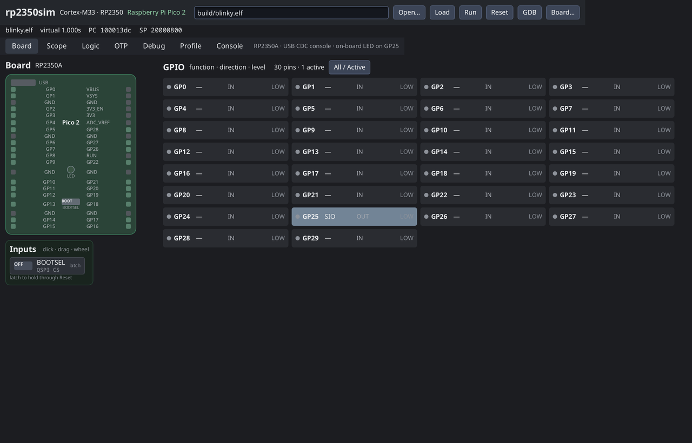

### Board inputs

Boards can declare interactive controls in `inputs:`. They appear under the
board diagram and drive the pins the firmware reads:

| kind | interaction | wiring |
|---|---|---|
| `button` | momentary press (or Space/Enter when focused) | one GPIO, active low by default |
| `switch` | click toggles the position | one GPIO |
| `encoder` | drag the knob, use the wheel, or `‹`/`›` | two GPIOs, one quadrature step per detent |
| `adc` | slider | GP26–GP29; sets the voltage the ADC channels and scope read |
| `bootsel` | momentary press | QSPI chip select, not a GPIO |

```yaml
inputs:
  - { kind: button, id: btn1, label: BTN 1, pin: 15 }
  - { kind: switch, id: sw1, label: SW 1, pin: 14, initial: false }
  - { kind: encoder, id: enc1, label: ENC 1, pin_a: 12, pin_b: 13 }
  - { kind: adc, id: pot1, label: POT 1, pin: 26, volts: 1.65, step: 0.05 }
  - { kind: bootsel, id: bootsel, label: BOOTSEL }
```

`active_low: false` inverts a button, switch or encoder line. Every board gets a
BOOTSEL control automatically (an explicit `bootsel` entry changes its label);
the board diagram's BOOTSEL button is always clickable too. It pulls the QSPI
chip select low; firmware
can read it through `SIO_GPIO_HI_IN` bit 27 (QSPI_CSN), as the TinyUSB BSP and
the bootrom do. The synthetic bootrom does not enter USB mass-storage boot mode,
so a held BOOTSEL is visible to firmware but does not start picoboot.

`--input ID=VALUE` sets controls before the first frame (repeatable), for
screenshots and scripted demos: `on`/`off` for buttons, switches and BOOTSEL, a
voltage for ADC inputs, and a signed step count for encoders (`enc1=+3`).
Encoder steps from `--input` are queued and delivered one per 20 ms of virtual
time, so firmware that samples the quadrature lines after boot counts them;
interactive clicks apply immediately.

`task ui:inputs` opens the `pico2-inputs` board with `firmware/c/inputs`, which
prints the control state on the Console tab and mirrors the button/switch on
GP25. `task c:inputs` runs the same firmware headlessly to check the idle
state.

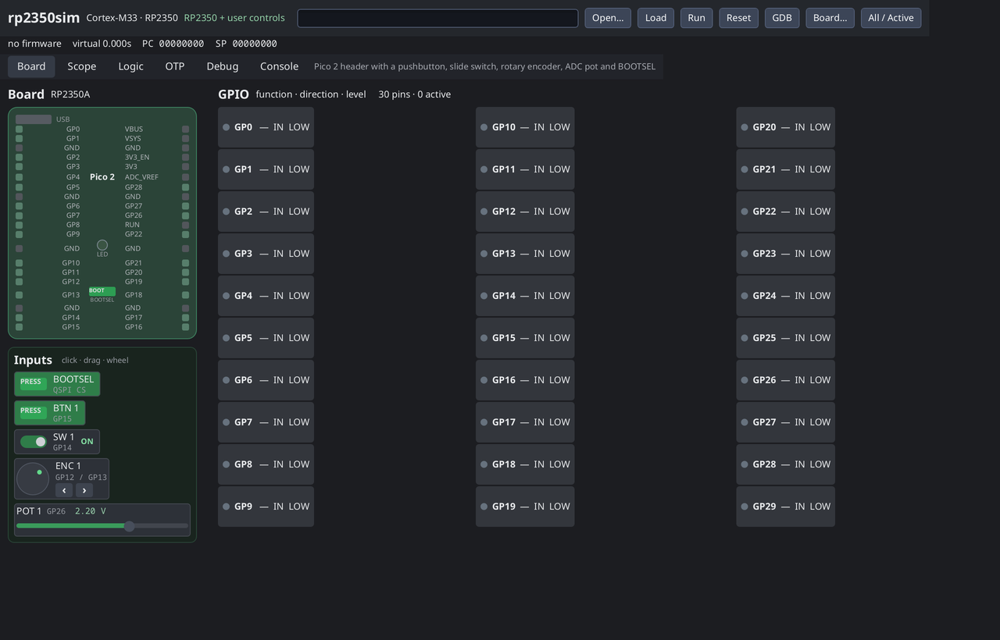

The `pico2b` board selects the QFN-80 package: the header diagram, GPIO table
and scope expose GP0–GP47 instead of the RP2350A's GP0–GP29.

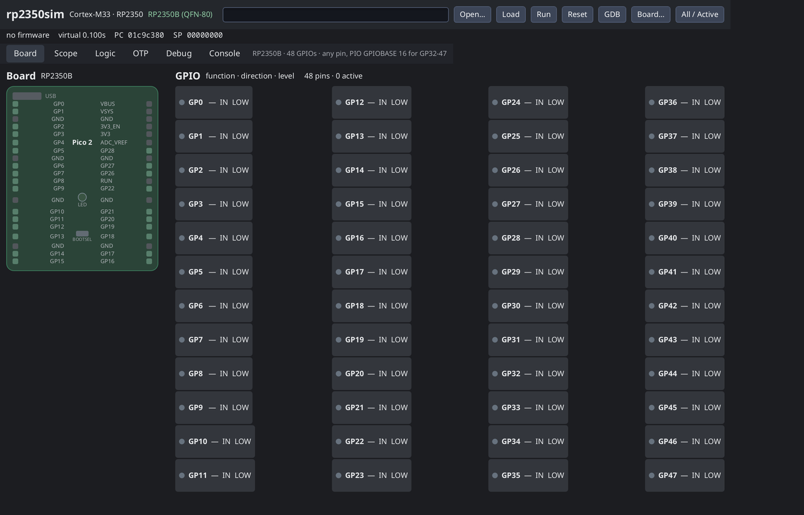

When the machine boots from a flash image (`--flash`), the status line names
the image and boot count. After an OTA self-update the board shows the new
entry point and write count, as in the banner below.


### LCD

The ST7789 framebuffer, only for boards with `lcd`. On a touch board, clicking
or dragging the panel injects a finger at the corresponding native panel
coordinate; the UI maps the displayed (rotated) frame back through the LCD
`rotation`. Release injects a lift.


### DVI

Shown when the board declares `hstx: true`. It displays the last complete
frame decoded from the HSTX command expander's RAW/TMDS stream (the Pico DVI
sock wiring on GP12-19) and offers **Save PNG**. Frames are captured at the
active width; the height is inferred from the common DVI modes (640x480,
320x240, 800x600, 1280x720). `--tab dvi --run SECONDS --png out.png` renders
one headlessly.

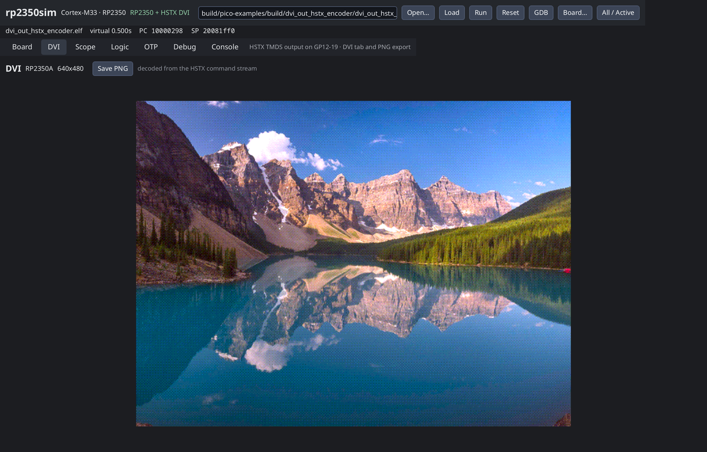

### Sensors

Boards with `touch`, `imu`, `battery` or `sd` get a Sensors tab showing the live
touch point, acceleration/rate, die temperature, battery voltage, PWM backlight
duty and card size. The card state is read-only.

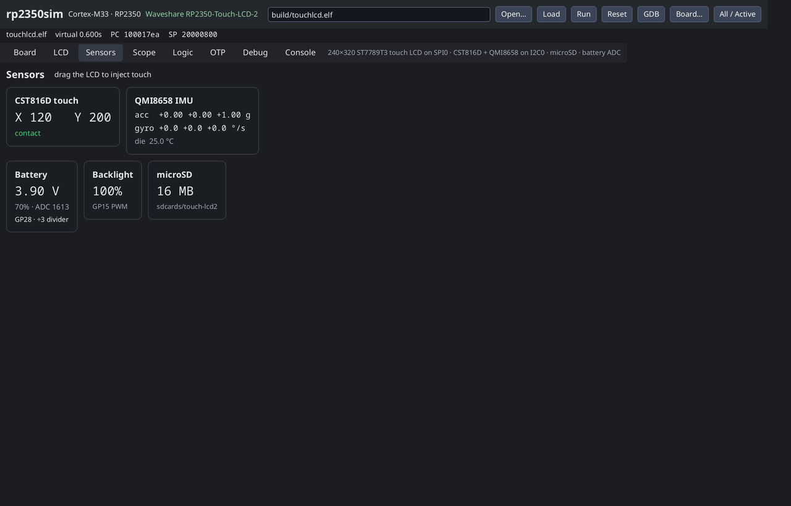

The `pico2-lcd-lab` board puts every timed device on one Touch-LCD-2; the LCD
tab shows the `firmware/lab` dashboard with 1-Wire, DHT, ultrasonic, GPS and CAN
readings at once. `task ui:lab` opens it; `ui:lab:png` renders it.

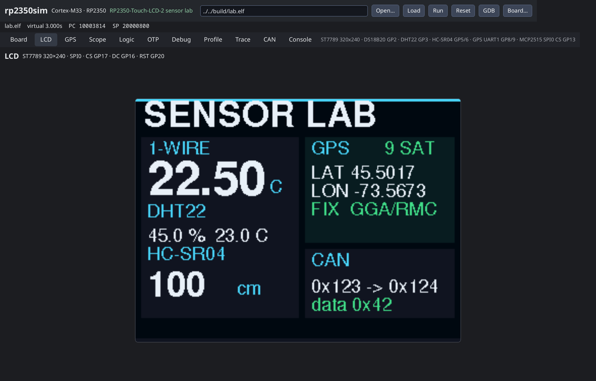

### Ethernet / Wi-Fi

The guest identity (IP, mask, gateway, MAC), one row per socket and a live log
for W5500, W6300, CH9120 or the virtual Wi-Fi transport. A listening socket
shows both the emulated device address and the **host address to connect to**
(for example `connect to 127.0.0.1:9002`), so the firmware can be exercised with
`nc` or a browser.


### LEDs

The last WS2812B frame as large swatches with its RGB values.


### Scope

Up to eight channels, each with its own colour, 0–3.3 V, 1 MHz sampling and a
~16 ms window. Click header pins to add/remove traces; all GPIOs are offered
(GP0–GP47; RP2350A packages only bond 0–29). The pin chips use width-aware rows,
so all 48 remain inside the window on narrow layouts. The legend shows the latest
voltage and a live measurement per channel: frequency, duty cycle and period,
using the same first-to-last-rising-edge method as `tools/pincheck` (with
"static high/low" when there are no edges).

The **Trigger** row selects Off/Rise/Fall/High/Low on a GPIO and **Rearm**
watches for the next event. The trigger GPIO is added to the scope channels if
it is not already selected. High/Low fire on the first sample at that level;
Rise/Fall wait for an edge. On a match the scope keeps a quarter-window of
post-trigger samples, freezes the trace and marks the trigger instant with an
orange dashed line; measurements then reflect the frozen window.

**Time Zoom −/+** changes the window from 1× to 64×; **Range −/+** selects 0.5,
1, 1.65, 2, 3.3 or 5 V full scale; **Reset** restores 1×/3.3 V. `analog:` board
entries generate waveforms (the `pico2-analog` board puts a 1 kHz sine on GP26,
which the ADC also reads).

**Show FFT** splits the tab into the time trace and a live spectrum (the button
becomes **Hide FFT**). It uses a Hann window and a one-sided real FFT of the
visible window, normalised to dBFS where the full-scale range is 0 dB. The
frequency axis defaults to a **log** scale over `binHz..Nyquist` (toggle
**Log/Lin**), with the selected channel and the **peak** frequency/level in the
header. With several channels, use the GP **−/+** selector; `--fft` opens the
spectrum view for headless renders. `task ui:scope:fft` and
`task ui:scope:fft:png` run/render it.

The scope and logic traces sample on a fixed virtual-time grid (1 MHz and
2 MHz) through periodic hooks, so they do not stop an idle core from being
fast-forwarded. A live window paces virtual time to real time (see the toolbar
note above), so the `virtual` counter tracks wall time unless the interpreter
cannot keep up, in which case it turns red; `--turbo` runs flat out. The Debug
tab pauses the chip.


### Logic

Board `logic:` protocols are tapped from the hardware models (UART, I2C, SPI)
or decoded from pin traces as a fallback for PIO/bit-banged signals. UART
bytes, I2C address/data/ACK phases and SPI MOSI/MISO bytes are listed under
synthesised waveforms; USB CDC transfers are listed with direction.

**Trigger** waits for Off/Any/UART/I2C/SPI, captures the trace and decoded lists
on the next event; **Pause: on** also stops the machine, both in the live loop
and in synchronous `--run` snapshots. **Rearm** waits for the next event after
a frozen capture. **Save trace** writes
`logic-analyze-trace-<date>-<board>.txt` in the current directory with the raw
pin samples, the decoded UART/I2C/SPI/USB sections and complete event logs for
every bus and direction. **Save VCD** writes
`logic-trace-<date>-<board>.vcd`, an IEEE 1364 value change dump of the digital
pins that opens directly in GTKWave or PulseView.


### Audio

Shown when the board declares an `audio:` source. The panel reports the
decoded format, draws the capture as a waveform and offers **Save WAV** and
**Play**. Playback is host-side only: the capture is written to a temporary
WAV and handed to `paplay`, `aplay`, `afplay` or `ffplay`. **Play** removes
the DC offset and applies a fixed headroom (−14 dB) first: a decoded GPIO or
PWM square wave is full scale, and a pin parked high decodes as DC, either of
which can damage speakers or hearing at system volume. **Save WAV** writes the
raw, unattenuated capture for analysis.


### MIDI

Shown when the board declares `midi:`. The monitor lists messages from the
firmware (USB-MIDI endpoint 3 or the tapped UART TX), newest first, with the
virtual cycle and raw bytes. The piano keyboard spans two octaves of the full
panel width with real white/black key geometry; keys the firmware plays light
up, and clicking or dragging plays a glissando. **−/+ Octave** moves the range
and **Panic** sends Note Off for held keys plus All Notes Off on all 16
channels. A key sends Note On on press and Note Off on release. Host-to-device
messages use the same USB-MIDI or UART endpoint as the headless runner. Board
changes flush Note-Off/All-Notes-Off to the old transport before switching.


### HID

See [hid.md](hid.md) for the USB HID model, headless flags and report
descriptor handling. Shown once the firmware enumerates a USB HID interface (keyboard, mouse,
gamepad or a composite). The monitor lists decoded reports newest first with the
virtual cycle, kind, readable text and raw bytes. The header names the
interfaces, their report kinds and interrupt endpoints.

The emulator is the USB host, so the monitor shows device-to-host reports. The
bottom row sends host-to-device output: **Num/Caps/Scroll** keyboard LEDs and a
generic output-report hex field (useful for gamepad rumble/feedback). Keyboard
LEDs use the report ID from the report descriptor; a boot keyboard without report
IDs gets the one-byte LED report.

```sh
task ui:hid          # TinyGo keyboard + mouse firmware
task ui:hidgamepad   # TinyGo joystick firmware
task ui:hid:composite # pico-sdk keyboard/mouse/media/gamepad, BOOTSEL latched
task ui:hid:png      # render this tab to build/ui-hid.png
```

### BOOTSEL

The virtual RPI-RP2 drive. It is shown when the board holds BOOTSEL, when no
firmware is loaded, or when the tab is selected. **Flash UF2…** opens a file
picker; the path field accepts one directly. The chosen file must carry a valid
RP2350 boot vector, but its UF2 family may be any RP2350 family: only flash
segments are installed, the flash is replaced and the machine boots the new
image. `UUID`/absolute metadata blocks are ignored.

The desktop window uses the click/path flow because Shirei (v0.10.0) exposes no
native OS file-drop event. The browser build also accepts a `.uf2` dropped
anywhere on the page.

```sh
task ui:bootsel      # open the virtual drive with no firmware
task ui:bootsel:png  # render it to build/ui-bootsel.png
```

### OTP

The RP2350 OTP array: 64 pages of 64 rows, each page showing its programmed-row
count and effective secure/non-secure lock. Click a page to inspect its rows
(data, raw 24-bit value and ECC status). The panel follows the last row the
firmware programmed until you pick a page. Nothing is persistent: seed rows
with the runner's `-otp` flag or dump them with `-otp-dump`.

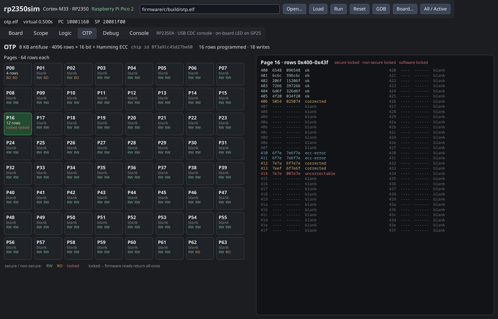

### Debug

The debugger view: Run/Pause/Step, cycle stepping, breakpoints by address or
symbol, write watchpoints, source/line and a lower inspector with
**Registers / Memory / Variables** tabs. The inspector is one third of the
window height. See [debug.md](debug.md) for the variable limitations and the
fixture tests.


### Profile

See [profiler.md](profiler.md) for the full recording model, LCOV semantics and
headless flags. **Profile** records a PC sample every 2048 cycles (about 14 us) and, while it
runs, exact instruction coverage. **Start** discards the previous run;
**Stop** freezes the report until the next start. `--tab profile` and
`--profile` start it before the warm-up, and `task ui:profile` /
`ui:profile:png` open it on blinky.

The summary shows profiled virtual time, samples, executed/total instructions
and IRQ entries. The function table is sorted by sampled cycles and gives each
function's share, samples, instruction coverage and hit count. The right column
shows the IRQ entry-latency histogram and the sampled MSP/PSP low-water marks
per core.

The tab uses ELF symbols and DWARF when available. A firmware without them
(the browser demo's packed tinychess, or a UF2/raw image) still profiles, but
the table shows 256-byte PC buckets and the tab says no DWARF was found. The
same data is available headlessly through `-coverage`, `-profile-out` and
`-profile-top` (see [cli.md](cli.md#profiling-and-coverage)).

### GPS

The GPS tab shows the attached NMEA 0183 source: fix state, latitude,
longitude, satellites, altitude, speed, course and the last emitted GGA/RMC
sentence. The sentences also arrive on the configured UART receive FIFO, so
the Logic tab or a firmware parser sees exactly the same stream. `task ui:gps`
opens it on `pico2-gps` with `firmware/gps`; `ui:gps:png` renders it.

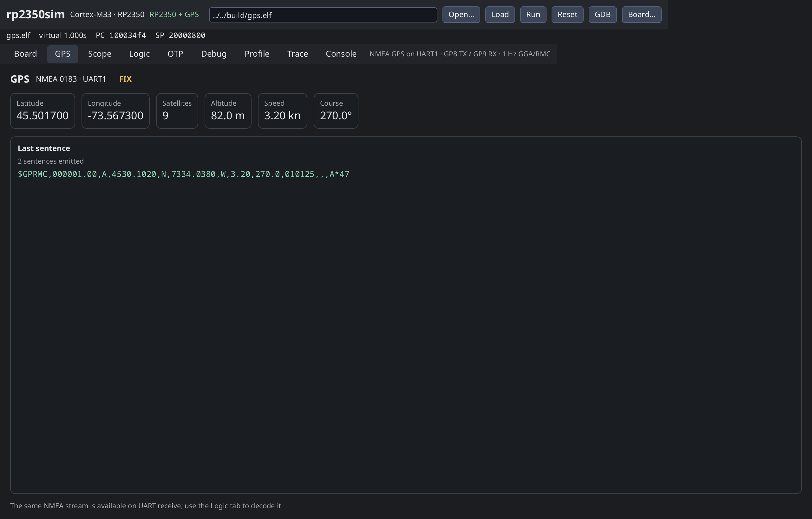

### CAN

The CAN tab shows the MCP2515 status registers and the recent bus frames with
bus time, identifier, standard/extended type and payload. It is a classic CAN
2.0B controller; the board's simulated peer answers a matching request.
`task ui:can` opens it with `firmware/can`; `ui:can:png` renders it.

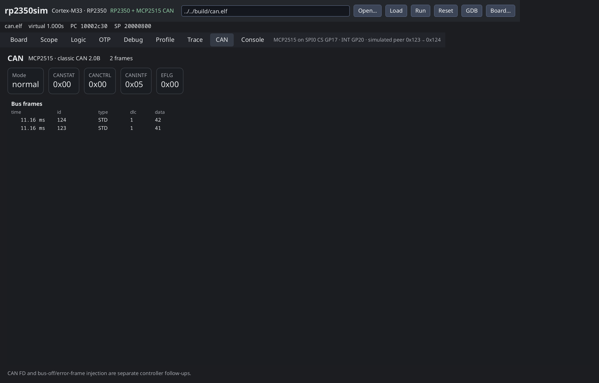

### Trace

The Trace tab lists ITM stimulus writes grouped into lines, with virtual time
and port, plus any other chip trace events. **Clear** drops the ring. The same
events are printed by the headless runner's `-itm` flag. `task ui:trace` opens
it on `firmware/c/itmdemo`; `ui:trace:png` renders it.

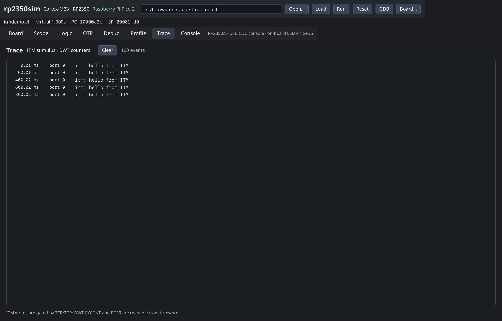

### Bus

The I2C/SPI tab lists the board's built-in presets (`i2c_presets` /
`spi_presets`), scripted device files (`i2c_plugins`, `spi_plugins`,
`serial_plugins`) and TCP bridges. A preset or plugin is attached directly to
the emulated controller, so firmware sees a real BME280, SSD1306, MPU6050 or
W25Q16 without an external script. The Scripted plugins card names each model,
its slot and load state, and shows the last `print`/`host_log` lines. See
[device plugins](plugins.md).


For TCP bridges, select a listening bridge and **Connect terminal** to act as
the device: the panel shows the Bus Pirate request tokens and sends the
`ACK`/`NAK`/hex responses you type. Responses are queued, so you can arm a
three-byte SPI read before the firmware asks for it. Each bridge keeps its own
terminal; the I2C and SPI devices can both be connected.

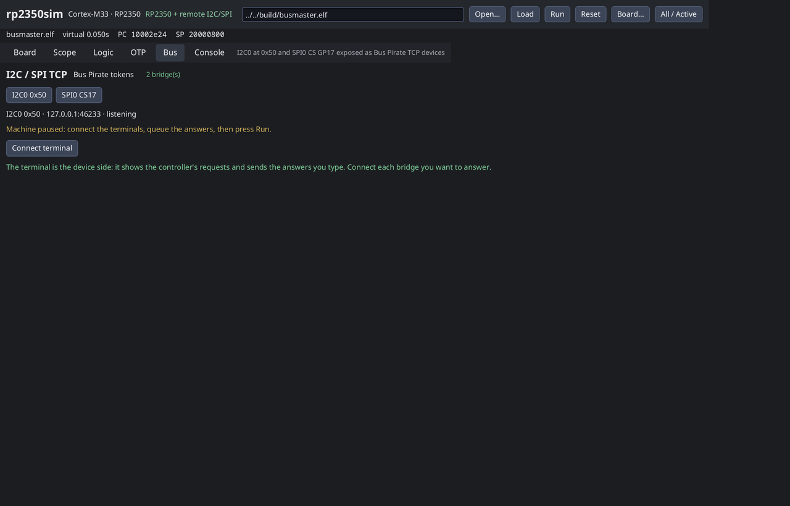

`task ui:bus` opens the `pico2-bus` board on this tab, paused. For the bundled
`busmaster`, connect I2C **and** SPI, queue `ACK ACK 0x12 0x34` and
`0xEF 0x40 0x18`, then press **Run**. The UI bridge deadline is 500 ms; a
missing answer returns NAK/`0xff` and the machine keeps running. Use **Reset
firmware** to restart after queueing when the firmware already ran.

Connect-mode bridges have no terminal: their external server is the device,
exactly like the CLI `=host:port` form. See
[bus-pirate.md](bus-pirate.md) for the token protocol and fake-device
examples.

### Live reload

`--watch` polls the loaded firmware (or `--flash` image) and restarts the
machine when it changes on disk. The baseline is captured when the path is
selected; a change must then be stable for two 200 ms polls, so a linker writing
the output in place is not executed half-finished. Reload and pause restoration
are atomic, and path/mode changes cannot be overwritten by a stale callback.
The status line shows `watch <name>` and the number of reloads; a load error
stays visible until the next successful change. The watcher follows a new path
when you press **Load** or pick another file.

```sh
rp2350sim-ui --board pico2 --watch build/blinky.elf
```

### Console

USB CDC + UART output. Click it to give it keyboard focus; typed text and
Enter/Backspace/Tab/arrows are forwarded to the firmware. UART0 receives input
immediately; USB input waits in a queue until CDC enumeration and the OUT
endpoint are ready. UART-over-TCP and bus-bridge status lines are listed here.

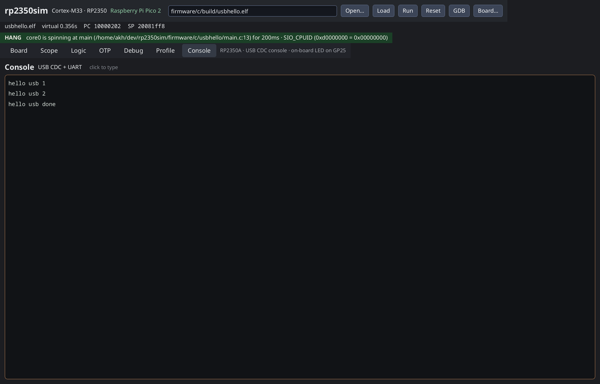

## UART over TCP

Add a bridge to a board:

```yaml
serial:
  - uart: 1
    # listen: 127.0.0.1:12401   (omit for a random free port)
```

The assigned address appears in the Console tab, e.g.
`UART1 tcp 127.0.0.1:39479 · listening`. Connect with `nc 127.0.0.1 39479`;
bytes go to the UART receive FIFO and firmware TX comes back on the same
connection. The listener is kept across firmware resets, so the port remains
stable while the UI is open.

## Headless snapshots

```sh
rp2350sim-ui --board geek --tab lcd --run 0.6 --png ui.png build/lcd.elf
rp2350sim-ui --board pico2-analog --tab scope --run 0.02 --png scope.png
rp2350sim-ui --board pico2-analog --tab logic --run 0.05 --png logic.png build/protocols.elf
rp2350sim-ui --board touch-lcd2 --tab sensors --touch 120,200 --run 0.6 \
  --png sensors.png build/touchlcd.elf
rp2350sim-ui --board pico2 --flash /tmp/ota-flash.bin --run 0.5 --png ota.png \
  firmware/c/build/ota.elf
rp2350sim-ui --board pico2 --tab debug --break main.marker --debug-tab variables \
  --run 0.6 --png debug.png build/debugvars.elf
rp2350sim-ui --board pico2-bus --tab bus --bus-connect \
  --bus-answer 'i2c=ACK ACK 0x12 0x34' --bus-answer 'spi=0xEF 0x40 0x18' \
  --run 1 --png bus.png build/busmaster.elf
```

`task ui:ota` opens the same setup live; `task ui:ota-png` writes
`build/ui-ota.png`. Every guide screenshot (picker, Board, inputs, LCD,
sensors, tabs, DVI, MIDI, audio, scope, logic, OTA) is regenerated with
`task docs:images` (rendered at 2x and downscaled to 1280×820). The Ethernet
and Wi-Fi captures start a temporary echo server on 127.0.0.1:9000.

## Keyboard

- Console focus: click the console panel. Text and special keys are forwarded
  to the firmware's USB CDC and UART0.
- The path text field owns typing while focused; the console does not steal it.
- Tab moves focus between focusable widgets.
- **Cmd+Q** (macOS) / **Ctrl+Q** quits.

See [peripherals.md](peripherals.md) for every device's CLI/UI workflow and
[boards.md](boards.md) for wiring.
